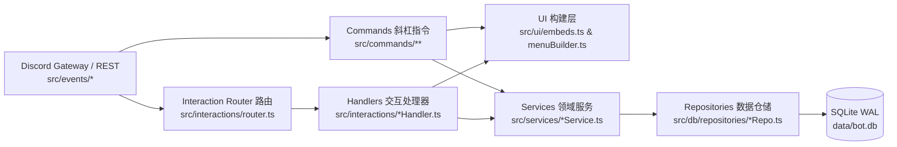
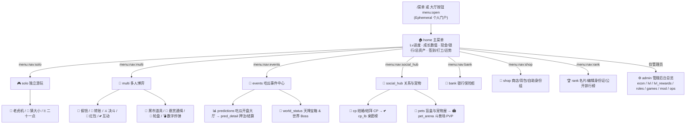

# 原生中文 Discord 多功能社群 Bot — 技术架构与运维文档

> 本文档面向项目维护者与二次开发者，基于当前代码库真实实现编写，涵盖分层架构、`/菜单` 全组件交互树与路由规范、全部 25 个斜杠指令、全量娱乐/博弈/世界事件/宠物与 CP 玩法数值规则、SQLite 28 表结构与平滑迁移机制，以及开发、测试和生产部署指南。

---

## 1. 项目架构与分层设计

### 1.1 技术栈与工程约束

| 维度 | 选型与配置 | 说明 |
| --- | --- | --- |
| 运行时 | Node.js（ES2022 / `NodeNext` ESM） | 源码 `import` 统一使用 `.js` 扩展名 |
| 语言与编译 | TypeScript `^5.8.3` | 开启 `strict: true`、`noUncheckedIndexedAccess: true`、`noImplicitOverride: true` |
| 代码规范 | ESLint `^9.26.0` + `typescript-eslint` | `@typescript-eslint/no-explicit-any: "error"`，**严格零 `any`** |
| Discord SDK | `discord.js` `^14.19.3` | Slash Commands、Embed、ActionRow、Button、String/User/Role Select、Modal |
| 数据库 | `better-sqlite3` `^11.10.0` | 单进程嵌入式 SQLite，生产文件库开启 `WAL` 与 `foreign_keys = ON` |
| 测试框架 | `vitest` `^3.1.3` | 使用 `:memory:` 与临时目录库隔离测试各层逻辑与路由 |
| 环境变量 | `dotenv` `^16.5.0` | 通过 `src/config/env.ts` 集中校验与解析 |

### 1.2 目录分层与数据流

项目采用单向依赖分层，确保业务逻辑可在不依赖 Discord Gateway 的情况下通过单元测试完整验证：



各目录职责说明：

- **`src/config/`**
  - `env.ts`：`parseEnv()` / `loadEnv()` 解析 `DISCORD_TOKEN`、`DISCORD_CLIENT_ID`、`DISCORD_GUILD_ID`、`DB_PATH`（默认 `./data/bot.db`）、`TIMEZONE`（默认 `Asia/Shanghai`）。
  - `defaults.ts`：定义 `ModuleToggles`（11 大模块开关）、`LevelingConfig`、`EconomyConfig`、`GamesConfig`（21 个新玩法/事件配置字段）、`WelcomeConfig`、`TicketConfig`、`GuildConfig` 接口及所有默认值常量。
- **`src/db/`**
  - `database.ts`：`createDatabase(dbPath)` 负责建目录、打开连接、设置 `journal_mode = WAL`（非内存库）与 `foreign_keys = ON`，并调用 `initSchema(db)`。
  - `schema.ts`：声明核心 13 张表并分别调用 `initRedPacketSchema(db)`、`initChaosSchema(db)`、`initWorldEventSchema(db)`、`initSocialPetSchema(db)`（合计 28 张表），随后执行幂等列迁移。
  - `repositories/`：12 个 Repository 类（`GuildConfigRepo`、`ProfileRepo`、`ShopRepo`、`FunRepo`、`TicketRepo`、`GiveawayRepo`、`InviteRepo`、`RolePanelRepo`、`RedPacketRepo`、`ChaosRepo`、`WorldEventRepo`、`SocialPetRepo`），封装全部 SQL 读写与行映射。
- **`src/services/`**
  - 纯业务与事务编排层：`AppContext.services` 注入 13 个领域服务实例（`LevelingService`、`EconomyService`、`BlackjackManager`、`ShopService`、`FunService`、`TicketService`、`GiveawayService`、`InviteService`、`RolePanelService`、`MultiplayerService`、`ChaosService`、`WorldEventService`、`SocialPetService`），另有 `permissionService.ts` 与 `welcomeService.ts` 两个无状态工具模块（`src/services/` 共 15 个文件）。涉及跨表/双人资金变动的接口全部使用 `this.db.transaction(...)()` 保证原子性。
- **`src/ui/`**
  - `embeds.ts`：定义全局 `AppContext`、`CommandDefinition`、`COLORS`、进度条 `renderProgressBar()`、中文时长格式化 `formatDurationZh()` 以及 Embed 工厂方法。
  - `localization.ts`：封装 `applyZh()` / `applyZhName()` 为指令、子指令与选项注入 `zh-CN` / `zh-TW` 本地化名称和描述。
  - `menuShared.ts` / `menuBuilder.ts` / `adminConfigMenuBuilder.ts` / `chaosMenuBuilder.ts` / `worldEventMenuBuilder.ts` / `socialPetMenuBuilder.ts`：模块化渲染器，构建大厅卡片 `buildLobbyMessage()`、个人互动面板 **37 个子视图**（29 个用户视图 + 8 个管理后台视图）、以及公开决斗、红包、轮盘、数字炸弹、吃瓜盘口、天降宝箱、世界 Boss、CP 求婚/结拜仪式与宠物斗兽场卡片。
- **`src/interactions/`**
  - `router.ts`：统一接收所有 `Interaction`（含 Button、StringSelect、UserSelect、RoleSelect、Modal）并按类型与 `customId` 前缀分发；全局捕获异常并向用户返回友好错误提示（含 `50013` 权限不足识别）。
  - `*Handler.ts` & `menuHelpers.ts`：13 个专题交互处理器 + 1 个公共工具模块（`menuHandler.ts`、`configMenuHandler.ts`、`gamesMenuHandler.ts`、`multiplayerHandler.ts`、`chaosHandler.ts`、`worldEventHandler.ts`、`socialPetHandler.ts`、`blackjackHandler.ts`、`leaderboardHandler.ts`、`helpHandler.ts`、`ticketHandler.ts`、`giveawayHandler.ts`、`rolePanelHandler.ts`、`menuHelpers.ts`）。
- **`src/commands/`**
  - `registry.ts`：汇总 25 个 `CommandDefinition` 并生成 `commandMap`（全部新玩法均直接收纳进 `/菜单`，不增加冗余斜杠指令）。
  - `guards.ts`：提供 `requireGuildMember`、`requireModuleEnabled`、`requireBotAdmin` 统一鉴权守卫。

### 1.3 `AppContext`、Gateway Intents 与后台调度器生命周期

`src/index.ts` 启动时按顺序组装：

1. **Intents 声明**：
   - `Guilds`、`GuildMembers`（Privileged）、`GuildMessages`、`MessageContent`（Privileged）、`GuildVoiceStates`、`GuildInvites`。（另在 Developer Portal 中开启 `Presence Intent` 等全部 3 个 Privileged Intents）。
2. **`AppContext` 注入**：
   - 持有 `db`、`timezone`、12 个 `repos` 实例和 13 个 `services` 实例，传递给所有指令与交互处理器。
3. **事件注册**：
   - `ready.ts`（`ClientReady`）、`messageCreate.ts`（聊天经验 + 世界事件活跃自动刷出）、`guildMemberAdd.ts`（邀请归因 + 自动身份组 + 欢迎 Embed）、`guildMemberRemove.ts`（离开通知）、`inviteEvents.ts`（`InviteCreate` / `InviteDelete` 实时维护内存邀请快照）、`interactionCreate.ts`（路由入口）。
4. **后台定时器（`src/events/ready.ts`）**：
   - **初始化任务**：设置状态 `正在观看 输入 /菜单 开始游玩 | /帮助`，并为所有已加入服务器拉取 `guild.invites.fetch()` 初始化邀请缓存（缺少 `ManageGuild` 权限时优雅跳过）。
   - **语音经验结算（`voiceTimer`，每 `60_000` ms / 60 秒）**：遍历语音频道中的非 Bot 成员；排除未进频道、位于服务器 `afkChannelId`、同时开启自闭麦与自闭听（`selfMute && selfDeaf`）及无真人在麦的情况；调用 `awardVoiceXp()` 并在升级时同步身份组与发送播报。
   - **抽奖自动开奖（`giveawayTimer`，每 `10_000` ms / 10 秒，带 `giveawayRunning` 防重入锁）**：拉取到期抽奖，执行 `finalizeGiveaway()` 更新原抽奖消息 Embed 并移除按钮，随后在原频道公开公告中奖者或流拍结果。
   - **红包过期退回（`redPacketTimer`，每 `15_000` ms / 15 秒，带 `redPacketRunning` 防重入锁）**：执行 `expireDueRedPackets()`，将过期未领完金额原子退回发包人口袋，编辑原红包卡片为过期状态并移除按钮，若 `refundedAmount > 0` 则在原频道发送退回提示 Embed。
   - **玩法与事件调度（`gamesTimer`，每 `5_000` ms / 5 秒，带 `gamesRunning` 防重入锁）**：
     - 俄罗斯轮盘：招募超过 10 分钟自动解散并全额退还入场费；游戏中超过 30 秒未扣扳机自动代扣（若触发吃鸡结局则发送全群胜出公告）。
     - 数字炸弹：超过 15 分钟未引爆自动拆弹关闭（`cancelled`）。
     - 吃瓜盘口：到达 `closesAt` 后自动封盘（`locked`）。
     - 世界事件：天降宝箱（5 分钟）与世界 Boss（10 分钟）过期结算；若 Boss 逃跑且存在有效输出玩家，自动发放 `30~150` 参与安慰奖并在频道发送逃跑公告 Embed。
     - CP 与宠物对战：CP 求婚/结拜仪式超 15 分钟自动过期并全额退还手续费；宠物斗兽场挑战超 10 分钟自动过期关闭（赌注仅在应战时扣划，无需退币）。所有状态变更均自动编辑原频道交互卡片。
5. **优雅退出**：监听 `SIGINT` / `SIGTERM`，依次执行 `schedulers.stop()`、`client.destroy()`、`db.close()`、`process.exit(0)`。

---

## 2. 可视化 `/菜单` 交互树与组件路由规范

### 2.1 `/菜单`（`/menu`）全视图交互树

用户可通过任意频道发送 `/菜单`（默认 `personal` 模式，Ephemeral 仅自己可见），或点击管理员通过 `/菜单 模式:lobby` 发送的永久大厅卡片按钮 `menu:open`，进入以下 **37 个视图**（含管理员 **8 个**后台视图）组成的完整交互面板：



全部 **37 个 `MenuView` 视图**（`src/ui/menuShared.ts`）：

| 类别 | 数量 | `page` 枚举清单与说明 |
| --- | --- | --- |
| **入口与个人玩法** | 6 | `home`（主菜单）、`solo`（独立游玩）、`slots`（老虎机）、`dice`（猜大小）、`bj`（二十一点）、`bank`（银行保险柜） |
| **多人博弈与整蛊** | 9 | `multi`（多人大厅）、`rob`（偷钱/肥羊榜）、`pay`（群友转账）、`duel`（骰子决斗）、`social`（趣味互动）、`props`（黑市道具）、`bounty`（悬赏通缉）、`roulette`（俄罗斯轮盘）、`bomb`（数字炸弹） |
| **吃瓜与世界事件** | 4 | `events`（事件中心）、`predictions`（盘口大厅）、`pred_detail`（盘口详情/押注/结算）、`world_status`（宝箱与世界 Boss） |
| **CP 社交与宠物** | 5 | `social_hub`（关系宠物中心）、`cp`（结婚/结拜管理）、`cp_lb`（全服亲密榜）、`pets`（盲盒与宠物屋）、`pet_arena`（斗兽场 PVP） |
| **商店、身份组与排行名片** | 5 | `shop`（服务器商店）、`bag`（背包与称号）、`self_roles`（自助领取身份组）、`rank`（个人名片 / 编辑身份证）、`leaderboard`（经验/富豪/成长数值/邀请榜） |
| **管理后台（仅管理员）** | 8 | `admin`（后台总览）、`admin_econ`（经济/抢钱/银行调参）、`admin_lvl`（等级/热度/语音/升级语调参）、`admin_lvl_rewards`（等级身份组奖励管理）、`admin_roles`（自助身份组面板管理）、`admin_games`（新玩法/事件/宠物/CP调参）、`admin_mod`（11 模块开关）、`admin_ops`（发币、设置成员成长数值与管理员授权） |

### 2.2 全量 `customId` 前缀路由规范

`src/interactions/router.ts` 通过 `interaction.customId.split(':')[0]` 提取前缀分发到对应处理器（`ticket:create` 模态框使用精确匹配）：

| 前缀 | 交互类型 | 处理器函数 | 完整 `customId` 格式与用途 |
| --- | --- | --- | --- |
| `menu` | Button / StringSelect / UserSelect / RoleSelect / Modal | `handleMenu*` + `tryHandleConfigMenu*` + `tryHandleGamesMenu*` | 主导航 (`menu:nav:*`)、独立玩法 (`menu:act:*` / `slots` / `dice_*` / `bj*`)、银行 (`menu:bank:*`)、身份证编辑 (`menu:modal:edit_card`)、自助身份组 (`menu:self_role_pick:*`)、黑市道具 (`menu:prop_buy` / `menu:prop_use:*` / `menu:user:prop_*`)、悬赏 (`menu:user:bounty` / `menu:bounty:clear`)、轮盘/炸弹建房 (`menu:roulette:*` / `menu:bomb:*` / `menu:roulette_join` / `menu:bomb_pick`)、吃瓜开盘 (`menu:modal:pred_create` / `menu:pred_*`)、世界事件 (`menu:world:*`)、CP/宠物 (`menu:user:cp_*` / `menu:cp_*` / `menu:pet:*` / `menu:user:pet_battle`)、管理后台 (`menu:admin:*` / `menu:admin_toggle_mod` / `menu:user:admin_*`（含 `admin_set_stat`）/ `menu:role:admin_lvl_reward_add` / `menu:role:admin_rp_add:<panelId>` / `menu:modal:admin_*`（含 `admin_lvl_msg`、`admin_rp_create`）) |
| `mp` | Button | `handleMultiplayerButton` | `mp:duel:accept:<id>` / `decline`（公开骰子决斗）；`mp:rp:claim:<id>`（拼手气红包） |
| `ch` | Button / Modal | `handleChaosButton` / `handleChaosModal` | Button：`ch:rl:join/leave/start/cancel/fire:<gameId>`（公开轮盘）、`ch:bomb:guess:<gameId>`（弹出猜数 Modal）；Modal：`ch:bomb_sub:<gameId>`（提交数字炸弹猜测） |
| `ev` | Button / StringSelect / Modal | `handleWorldEventButton` / `handleWorldEventStringSelect` / `handleWorldEventModal` | Button：`ev:pred:bet:<predId>:<opt>`（弹下注 Modal）、`ev:pred:lock/cancel/refresh:<predId>`、`ev:chest:claim:<eventId>`、`ev:boss:hit:<eventId>:<normal\|heavy>`；StringSelect：`ev:pred:settle:<predId>`；Modal：`ev:pred_bet_sub:<predId>:<opt>` |
| `sp` | Button | `handleSocialPetButton` | `sp:prop:accept/decline:<proposalId>`（求婚/结拜仪式）；`sp:petbattle:accept/decline:<battleId>`（宠物斗兽场 PVP） |
| `lb` | Button | `handleLeaderboardButton` | `lb:<xp\|coins\|invites\|stat>:<page>[:prev\|:next]`（`/排行榜` 及 `/菜单` 点击排行榜发送的公开互动排行榜翻页与切榜，`:prev`/`:next` 后缀避免单页 `customId` 冲突） |
| `bj` | Button | `handleBlackjackButton` | `bj:<hit\|stand\|double>:<ownerId>`（`/二十一点` 独立牌局按钮） |
| `help` | StringSelect | `handleHelpSelect` | `help:category`（`/帮助` 模块分类下拉切换） |
| `ticket` | Button / Modal | `handleTicketButton` / `handleTicketModal` | `ticket:open` / `ticket:close` / `ticket:create` |
| `giveaway` | Button | `handleGiveawayButton` | `giveaway:join:<giveawayId>` |
| `rolepanel` | Button / StringSelect | `handleRolePanelButton` / `handleRolePanelSelect` | `rolepanel:btn:<panelId>:<roleId>` / `rolepanel:select:<panelId>` |

### 2.3 Ephemeral 隐私隔离与公开广播策略

- **🔒 纯私密操作（仅自己可见，Ephemeral 原地刷新）**：`/菜单`（`personal`）、点击大厅按钮 `menu:open`、面板页面跳转、每日签到、打工、普通运势抽签、普通老虎机/猜大小/二十一点胜负、银行存/取款与领息、商店购买、背包使用，均通过 `interaction.update()` 原地刷新，不在公共频道刷屏。
- **📢 多人互动公开播报与防打扰提及（Mention）分层策略**：
  - **常规广播默认不艾特（`allowedMentions: { parse: [] }`）**：`sendPublicBroadcast()` 默认屏蔽一切 `@` 提醒。**普通偷钱/打劫**（`menu:user:rob` 与 `/rob` 文本展示昵称而非 `<@id>`）、**群友转账**（`menu:modal_sub:pay:*`）、**趣味互动**（`menu:user:social:*`）、黑市 `衰神符` / `改昵称卡`、常规高光喜报、名片晒出与排行榜等均在当前频道公开展示但不推送红点艾特（若无发送权限则私密提示警告）。
  - **强相关/待响应事件保留真实艾特（`allowedMentions: { users: [...] }`）**：仅**悬赏发布与抢赏兑现**、**PVP 骰子决斗发起**（`mp:duel:*`）、**CP 求婚/结拜仪式**（`sp:prop:*`）与**定向宠物斗兽场约战**（`sp:petbattle:*`）会显式传入 `allowedMentions: { users: [...] }` 真实艾特相关当事成员。
  - **拼手气红包（`mp:rp:claim:*`）**：在频道发出公开交互卡片；他人点击时原地刷新公开卡片，抢包具体金额与校验失败提示以 Ephemeral `followUp` / `reply` 发给操作人。
  - **吃瓜、博弈与世界事件（`ch:` / `ev:` / `sp:`）**：轮盘赌桌与吃鸡结算、数字炸弹抢猜与引爆分红、吃瓜盘口卡片与结算、天降宝箱/世界 Boss 刷出及击杀/逃跑播报、亲密里程碑称号解锁、宠物斗兽场战报均在当前频道（或指定 `eventChannelId`）公开展示；抽中 `SR`/`SSR` 稀有宠物也会自动在频道发布欧皇喜报。
- **🌟 独立游玩高光喜报 & 公开排行榜广播**：
  - 老虎机转出 `>= 4x` 三连、猜大小押中 `10x` 豹子、二十一点打出天胡 Blackjack 或单局净赢 `>= 500`、每日运势首抽抽中【大吉】时，自动在频道发布欧皇喜报（不触发艾特）。
  - 在 `/菜单` 中点击任意排行榜按钮（`menu:rank:*`）时，会直接通过 `buildLeaderboardMessage()` 向当前频道发送一张带翻页/切榜按钮的**公开互动排行榜**，全群成员均可直接查看、翻页或切换榜单。名片与 CP 亲密榜也提供 `📢 晒出我的名片` / `📢 晒出排行榜` / `📢 晒出亲密榜`（`menu:share:*`），按需分享到当前频道。
  - `sendPublicBroadcast()` 会先检查 `interaction.channel?.isSendable()`，若 `interaction.channel` 为空则通过 `client.channels.fetch(channelId)` 兜底获取可发消息频道，默认使用 `{ parse: [] }`，仅高优先级场景覆盖为 `{ users: [...] }`。

### 2.4 Discord 组件硬限制与工程护栏

代码库（含 `tests/ui/menuBuilder.test.ts` 与 `tests/interactions/menuRouter.test.ts`）强制校验以下 Discord API 约束：

1. **组件布局上限**：每条消息最多 `5` 个 `ActionRow`；每行最多 `5` 个按钮；`StringSelectMenu`、`UserSelectMenu` 与 `RoleSelectMenu` 必须独占一整行（`row.components.length === 1`）。
2. **下拉菜单选项上限**：每个 `StringSelectMenu` 必须在 `1 ~ 25` 个选项之间。商店与背包视图在渲染前执行 `.slice(0, 25)` 并于描述中注明总数；身份组面板在 `addOption()` 限制最多 `25` 个。
3. **字符串长度截断与弹窗标签上限**：`truncateText()` 保障按钮标签 `<= 80` 字符，Select 选项 `label`/`description` `<= 100` 字符，Embed `title <= 256`、`description <= 4096`，`customId <= 100` 且同一消息内不重复；Modal `TextInputBuilder` 的 `label` 受 `@sapphire/shapeshift` 约束不得超过 **`45` 字符**。
4. **`showModal()` 响应时序铁律**：Discord 规定 `showModal()` 必须是交互的**首次且唯一**响应，**严禁**在其前面调用 `deferUpdate()`、`reply()` 或 `update()`。`menuHandler.ts` 中 `menu:modal:*`、`menu:user:pay`、`menu:user:duel` 均严格遵守该顺序。
5. **Modal 回写原面板 (`isFromMessage()`)**：`respondFromModal()` 判断 `interaction.isFromMessage()`，为 `true` 时调用 `interaction.update(msg)` 直接刷新原 Ephemeral 面板，防止每填一次弹窗就多弹出一条新消息。
6. **频道可发送守卫 (`channel?.isSendable()`)**：所有需要向频道发送公开大厅、转账通知、决斗卡片、红包卡片、互动播报或过期退款通知的逻辑，均先检查 `interaction.channel?.isSendable()`（及发送异常兜底回滚）。

---

## 3. 全部 25 个斜杠指令清单

所有指令定义汇总于 `src/commands/registry.ts`（`commands` 数组共 25 个）。默认使用 `applyZh()` 将 `zh-CN` 同步写入 `zh-TW`；`/menu` 额外显式配置繁体名称 `選單`。

| # | 英文指令 | `zh-CN` | `zh-TW` | 所属模块 | 权限 | 用途说明 |
| --- | --- | --- | --- | --- | --- | --- |
| 1 | `/help` | `/帮助` | `/帮助` | 通用 | 所有成员 | 查看全部功能说明与交互式模块分类下拉菜单 |
| 2 | `/menu` | `/菜单` | `/選單` | 通用 / 全功能 | 成员 / 管理员(`lobby`) | 打开个人 Ephemeral 互动主面板，或由管理员在频道发送永久大厅入口按钮 |
| 3 | `/config` | `/设置` | `/设置` | 通用配置 | 管理员 | 查看配置、开关模块、增删管理员身份组/用户、忽略/倍率频道、发放星币 (`grant-coins`) 及全员发币 (`grant-all-coins`) |
| 4 | `/rank` | `/等级` | `/等级` | 等级与热度 | 所有成员 | 查看自己或指定成员的自定义名片（昵称/标签/简介/颜色）、等级、独立成长数值、经验进度条、全服排名与热度倍率 |
| 5 | `/leaderboard` | `/排行榜` | `/排行榜` | 等级与综合 | 所有成员 | 查看经验榜、星币富豪榜（含银行资产）、成长数值榜 (`stat`) 或邀请贡献榜（带按钮翻页与切榜） |
| 6 | `/level-admin` | `/等级管理` | `/等级管理` | 等级与热度 | 管理员 | 配置升级奖励身份组、升级播报频道与自定义标题/文案模板、语音挂机经验、热度/冷却/小时上限、设置用户经验与设置成长数值 (`set-stat`) |
| 7 | `/daily` | `/签到` | `/签到` | 经济系统 | 所有成员 | 领取每日签到星币（连签递增加成，按配置时区日切） |
| 8 | `/work` | `/打工` | `/打工` | 经济系统 | 所有成员 | 触发随机打工事件赚取星币（带冷却限制） |
| 9 | `/rob` | `/打劫` | `/打劫` | 经济系统 | 所有成员 | 尝试偷取群友口袋现金（银行存款免疫；失败需赔款，被抢触发护盾） |
| 10 | `/balance` | `/钱包` | `/钱包` | 经济系统 | 所有成员 | 查询自己或他人的口袋现金、银行存款、总资产、连签天数与佩戴称号 |
| 11 | `/pay` | `/转账` | `/转账` | 经济系统 | 所有成员 | 从口袋现金向指定群友直接转账 |
| 12 | `/dice` | `/猜大小` | `/猜大小` | 经济系统 | 所有成员 | 三颗骰子押大（1x）、押小（1x）或押豹子（10x） |
| 13 | `/slots` | `/老虎机` | `/老虎机` | 经济系统 | 所有成员 | 拉动加权老虎机，三连 `7️⃣` 最高 15 倍返还 |
| 14 | `/blackjack` | `/二十一点` | `/二十一点` | 经济系统 | 所有成员 | 开始一局独立互动二十一点扑克（按钮要牌 / 停牌 / 双倍下注） |
| 15 | `/shop` | `/商店` | `/商店` | 经济系统 | 成员 / 管理员 | 浏览和购买身份组、称号、经验卡；管理员上/下架商品 |
| 16 | `/inventory` | `/背包` | `/背包` | 经济系统 | 所有成员 | 查看背包道具与称号，激活经验加成卡或切换佩戴称号 |
| 17 | `/fortune` | `/运势` | `/运势` | 娱乐互动 | 所有成员 | 抽取今日运势签（大吉~小凶、宜/忌、幸运数字，首抽赠星币） |
| 18 | `/interact` | `/互动` | `/互动` | 娱乐互动 | 所有成员 | 对群友发起摸头/抱抱/贴贴/戳一戳/投喂/丢雪球并累计交互次数 |
| 19 | `/title` | `/称号` | `/称号` | 娱乐互动 | 成员 / 管理员(`grant`) | 查看、佩戴、卸下个人称号，或由管理员授予成员专属称号 |
| 20 | `/welcome-config` | `/欢迎设置` | `/欢迎设置` | 欢迎与离开 | 管理员 | 设置入群欢迎语、离开提示、自动身份组、功能开关与实时预览 |
| 21 | `/ticket-config` | `/工单设置` | `/工单设置` | 工单系统 | 管理员 | 配置工单分类、客服身份组、日志频道、并发上限与发送「创建工单」面板 |
| 22 | `/ticket` | `/工单` | `/工单` | 工单系统 | 客服 / 创建者 | 在开启中的工单频道内拉入成员、移除成员或关闭工单 |
| 23 | `/giveaway` | `/抽奖` | `/抽奖` | 抽奖系统 | 管理员 | 发起带门槛的定时抽奖、提前开奖、重抽与查看进行中列表 |
| 24 | `/invites` | `/邀请` | `/邀请` | 邀请追踪 | 所有成员 | 查看自己或指定成员的累计成功邀请数与近期邀请记录 |
| 25 | `/role-panel` | `/身份组面板` | `/身份组面板` | 自助身份组 | 管理员 | 创建与发布支持按钮/下拉菜单、单选互斥/多选的自助身份组面板 |

> 注：**Bot 管理员权限 (`requireBotAdmin` / `checkMemberIsBotAdmin`)** 满足以下任一条件即可通过：服务器 `Administrator` 权限、`ManageGuild` 权限、持有 `/设置 添加管理员身份组` 配置的 `adminRoleIds`，或用户 ID 位于 `/设置 添加管理员用户`（或后台 `admin_ops`）配置的 `adminUserIds` 白名单中。授权成员在 `/菜单` 首页可见「⚙️ 管理后台」（含 `admin` / `admin_econ` / `admin_lvl` / `admin_lvl_rewards` / `admin_roles` / `admin_games` / `admin_mod` / `admin_ops` **8 个**可视化配置视图）。

### 3.1 11 大功能模块开关（`ModuleToggles`）

所有模块开关定义于 `src/config/defaults.ts`（默认全部为 `true`），可通过 `/设置 开关模块`（`MODULE_CHOICES`）或 `/菜单` → `⚙️ 管理后台` → `🧩 模块开关`（`admin_mod`）实时切换：

| 模块键 (`ModuleKey`) | 中文显示名 | 默认值 | 管控功能范围 |
| --- | --- | --- | --- |
| `leveling` | 等级与热度 | `true` | 聊天/语音经验、热度连击、`/等级`、经验榜、名片晒出 |
| `economy` | 经济系统 | `true` | 签到、打工、打劫、钱包/银行/利息、转账、老虎机/猜大小/二十一点、决斗、红包、商店背包及消耗现金的玩法扣费校验 |
| `fun` | 娱乐互动 | `true` | `/运势`、`/互动`（趣味动作）、`/称号` |
| `welcome` | 欢迎与离开 | `true` | 入群欢迎 Embed、退群提示、入群自动身份组 |
| `tickets` | 工单系统 | `true` | 工单创建面板与私密客服工单频道管理 |
| `giveaways` | 抽奖系统 | `true` | 定时抽奖发起、参与、自动/提前开奖与重抽 |
| `invites` | 邀请追踪 | `true` | 邀请码缓存归因、`/邀请`、邀请榜 |
| `rolePanels` | 自助身份组 | `true` | 按钮/下拉菜单自助身份组面板（单选/多选） |
| `socialGames` | 整蛊与博弈 | `true` | 黑市攻防道具、悬赏通缉令、俄罗斯轮盘、数字炸弹 |
| `worldEvents` | 吃瓜与世界事件 | `true` | 自由吃瓜开盘、天降宝箱、世界 Boss（含活跃自动触发） |
| `petsAndCp` | 关系与宠物 | `true` | 结婚/结拜 CP 打卡称号、亲密度榜、盲盒抽宠养成、宠物斗兽场 PVP |

### 3.2 `admin_games` 可视化调参 UI 与 `GamesConfig` 21 字段清单

在 `/菜单` → `⚙️ 管理后台` → `🎮 玩法与事件调参`（`menu:nav:admin_games`）中，管理员可通过 **4 个预填参数弹窗（Prefilled Modals）** 与 **5 个快捷管理按钮** 实时修改 `guild_configs.games_config_json`：

- **4 个预填弹窗（`menu:modal:*` → `menu:modal_sub:*`）**：
  1. `admin_props`（`🧰 道具价格`）：预填并校验 5 项黑市道具价格（`trap`、`lockpick`、`shield`、`curse`、`nickname`，均允许整数 `0 ~ 100,000`）。
  2. `admin_events`（`🎁 事件与Boss`）：预填并校验 `threshold`（自动触发发言数 `5~500`）、`cooldown`（事件冷却秒数 `60~86,400`）、`bossHp`（Boss 基础 HP `100~100,000`）、`bossPool`（Boss 奖池 `100~1,000,000`）、`chestRange`（宝箱总额范围 `min-max`，各 `10~500,000` 且 `min <= max`）。
  3. `admin_pets_cp`（`🐾 宠物与CP`）：预填并校验 `petGachaPrice`（抽盲盒 `0~100,000`）、`petFeedPrice`（喂食 `0~10,000`）、`petMaxOwned`（单人宠物上限 `1~25`）、`cpProposeCost`（求婚/结拜费 `0~100,000`）、`cpMaxSworn`（结拜上限 `1~10`）。
  4. `admin_bounty`（`🎯 悬赏参数`）：预填并校验 `minAmount`（最低悬赏 `1~100,000`）、`clearMult`（自费撤单倍率 `1.0~5.0`）。
- **5 个快捷管理按钮（`menu:admin:*`）**：
  - `toggle_auto_event`：一键开/关群聊活跃自动刷出宝箱或 Boss（`eventAutoEnabled`）。
  - `toggle_event_channel`：绑定当前频道为专属事件频道，或解绑恢复在当前活跃发言频道降临（`eventChannelId`）。
  - `spawn_chest` / `spawn_boss`：立即向目标事件频道投放宝箱或召唤世界 Boss。
  - `reset_games`：恢复 `DEFAULT_GAMES_CONFIG` 默认值（保留已绑定的 `eventChannelId`）。

**`GamesConfig` 全部 21 个配置字段与默认值（`src/config/defaults.ts`）**：

| # | 字段名 | 默认值 | 说明 |
| --- | --- | --- | --- |
| 1 | `propTrapPrice` | `500` | 黑市道具：🪤 捕兽夹价格 |
| 2 | `propLockpickPrice` | `400` | 黑市道具：🗝️ 万能撬锁价格 |
| 3 | `propShieldPrice` | `600` | 黑市道具：🛡️ 防盗保险价格 |
| 4 | `propCursePrice` | `300` | 黑市道具：🧿 衰神符价格 |
| 5 | `propNicknamePrice` | `1000` | 黑市道具：🎭 改昵称卡价格 |
| 6 | `bountyMinAmount` | `200` | 单笔最低悬赏金额 |
| 7 | `bountyClearMultiplier` | `1.5` | 目标自费撤单赏金倍率 |
| 8 | `eventChannelId` | `null` | 世界事件固定发布频道 ID（`null` 表示随活跃频道刷出） |
| 9 | `eventAutoEnabled` | `true` | 是否启用群聊活跃自动刷出世界事件 |
| 10 | `eventMsgThreshold` | `30` | 自动触发世界事件所需的非 Bot 累计发言数 |
| 11 | `eventCooldownSec` | `1800` | 自动世界事件冷却时间（秒，默认 30 分钟） |
| 12 | `bossBaseHp` | `1000` | 世界 Boss 基础血量 |
| 13 | `bossRewardPool` | `3000` | 世界 Boss 基础讨伐奖池 |
| 14 | `chestRewardMin` | `800` | 天降宝箱随机总奖池下限 |
| 15 | `chestRewardMax` | `2000` | 天降宝箱随机总奖池上限 |
| 16 | `chestShares` | `5` | 天降宝箱可领取总份数（代码中钳制 `1~20`） |
| 17 | `petGachaPrice` | `500` | 盲盒抽宠单次价格 |
| 18 | `petFeedPrice` | `80` | 宠物每日喂食费用 |
| 19 | `petMaxOwned` | `12` | 单人宠物栏位上限 |
| 20 | `cpProposeCost` | `500` | 求婚/结拜仪式手续费 |
| 21 | `cpMaxSworn` | `3` | 单人最多可结拜死党人数上限 |

---

## 4. 核心玩法与经济数值规则

### 4.1 等级、经验公式、独立成长数值与聊天热度连击

代码位置：`src/services/levelingService.ts`、`src/config/defaults.ts`、`src/events/ready.ts`。

- **升级所需经验公式**（从 `level` 升至 `level + 1`，前期快速升级、后期陡峭）：
  $$\text{XP}_{\text{next}}(L) = 40 + 20L + 10L^2 + 2L^3$$
- **任意高等级支持 (`level_offset`) 与排行排序**：`member_profiles.level_offset` 支持在不触发 64 位整数/JS `MAX_SAFE_INTEGER` 溢出的前提下设置或保留超高显示等级；经验榜与全服经验排名统一按 `level DESC, xp DESC` 排序。
- **聊天经验计算链路**（`awardMessageXp`）：
  1. 检查模块开关、**频道白名单 (`allowedChannelIds`)**（非空时仅白名单内频道可获得聊天经验；`reset_lvl` 重置默认参数时保留已配置白名单）、**忽略频道 (`ignoredChannelIds`)** 与发言冷却（默认 `cooldownSec = 15` 秒）。
  2. 计算热度窗口：若 `nowMs - lastXpAt <= heatWindowSec * 1000`（默认 `180` 秒），`heatStreak + 1`，否则重置为 `1`。
  3. 基础随机经验：`baseXp ∈ [baseMinXp, baseMaxXp]`（默认 `15 ~ 25`）。
  4. 最终经验：`Math.max(1, Math.round(baseXp * heatMultiplier * channelMultiplier * boostMultiplier))`。
  5. **每小时经验上限**：默认 `hourlyXpCap = 1200` XP（滑动 `3_600_000` ms 窗口；设为 `0` 表示不限制）。
- **聊天热度连击倍率阶梯**（`getHeatMultiplier`，受限于 `heatMaxMultiplier`，默认上限 `2.0x`）：

| 连续有效发言次数 (`heatStreak`) | 原始热度倍率 |
| --- | --- |
| `< 2`（0 或 1 次） | `1.0x` |
| `>= 2` | `1.25x` |
| `>= 4` | `1.5x` |
| `>= 6` | `1.75x` |
| `>= 8` | `2.0x` |

- **语音挂机经验**：默认开启，每 `60` 秒结算 `voiceXpPerMin = 10` XP（乘以激活中的经验卡倍率，受 `hourlyXpCap` 约束，**不吃热度倍率**）。不计入 Bot、AFK 频道及同时自闭麦+自闭听成员。
- **独立成长数值（与等级解耦）**：
  - 通过 `statEnabled`（默认 `true`）、`statName`（默认 `成长值`）、`statUnit`（默认 `点`）、`statMinGain`（默认 `1`）、`statMaxGain`（默认 `3`）配置，存储于 `member_profiles.stat_value`。
  - 每次升级按升阶次数累计随机增长，完全独立于 `level` 数值本身；支持专属 `stat` 排行榜，且管理员可通过 `/level-admin set-stat` 或 `/菜单` 管理后台 `admin_ops`（`menu:user:admin_set_stat`）直接设定成员数值（`0 ~ 1,000,000,000`）。
- **升级奖励、自定义播报与个人身份证名片**：
  - 每升 1 级默认赠送 `levelUpCoinReward = 100` 星币；若配置了等级身份组奖励，根据 `stackRoles` 决定叠加保留（`true`）或仅保留最高级（`false`）。
  - 支持通过 `levelUpTitle` 与 `levelUpTemplate` 自定义升级公告，模板支持占位符：`{user}`、`{username}`、`{level}`、`{oldLevel}`、`{coins}`、`{currency}`、`{roles}`、`{stat}`、`{statGained}`、`{statUnit}`。
  - 用户可在 `/菜单` → `rank` 通过 `✏️ 编辑身份证` 定制 `card_nickname`、`card_tag`、`card_bio` 与 `card_color`（Hex 颜色），并在 `/rank`、个人名片与公开晒卡中展示。

### 4.2 口袋现金 vs 银行保险柜与每日利息

代码位置：`src/services/economyService.ts`、`src/db/repositories/profileRepo.ts`。

| 资产类型 | 数据库字段 | 用途与规则 |
| --- | --- | --- |
| **口袋现金** | `member_profiles.coins` | 日常流动资金：用于玩小游戏（老虎机/猜大小/二十一点）、商店消费、转账、发起/接受决斗、发红包；**可被其他成员打劫** |
| **银行存款** | `member_profiles.bank_coins` | 安全储蓄：仅可在 `/菜单` → `银行存钱` 存取；**完全免疫 `/打劫` 与偷钱**（`rob()` 既不读取也不扣减 `bankCoins`） |
| **总资产排行** | `coins + bank_coins` | 富豪榜按 `(coins + bank_coins) DESC, coins DESC, xp DESC` 排序 |

- **银行每日利息规则**（`claimBankInterest`）：
  - 默认配置：`bankInterestRate = 0.02`（2%）、`bankInterestMax = 500` 星币/日、`bankInterestMinDeposit = 100` 星币。
  - 日切判断：基于 `getDateKey(nowMs, timezone)`（默认 `Asia/Shanghai`，即 **UTC+8 零点重置**），校验 `lastBankInterestDate === today`；每日限领一次。
  - 利息计算：当 `bankCoins >= bankInterestMinDeposit` 时：
    $$\text{interest} = \max\left(1, \min\left(\text{bankInterestMax}, \lfloor \text{bankCoins} \times \text{bankInterestRate} \rfloor\right)\right)$$
  - 利息直接原子计入 `bankCoins`，不进入口袋现金。

### 4.3 签到、打工与打劫规则

- **每日签到（`claimDaily`）**：基础 `dailyBase = 200`；若昨日已签则 `dailyStreak + 1`，否则重置为 `1`；连签加成 `Math.min((streak - 1) * 30, 300)`（默认最高合计 `500` 星币/天），按 `TIMEZONE` 日切。
- **打工（`work`）**：随机收益 `[80, 220]`（可配），冷却 `workCooldownSec = 1800` 秒（30 分钟）。
- **偷钱 / 打劫（`rob`）**：
  - 冷却：`robCooldownSec = 3600` 秒（1 小时）；肥羊榜 (`listRobTargets`) 展示口袋现金 `>= 100` 的前 8 名非本人成员。
  - 目标门槛：仅允许打劫 `target.coins >= 100` 且不在护盾期内的用户（不可打劫自己或 Bot）。
  - **成功**（概率 `robSuccessRate = 0.45`）：偷走目标口袋现金 `15% ~ 35%`（钳制在 `[15, 1000]` 且不超过目标实际现金），同时为目标开启 `robTargetShieldSec = 3600` 秒（1 小时）防盗护盾。
  - **失败**（概率 `55%`）：攻击者向目标赔偿自己口袋现金的 `15%`（钳制在 `[50, 500]` 且不超过攻击者现有现金）；攻击者进入 1 小时冷却，目标不触发护盾。

### 4.4 个人娱乐与赌场赔率

- **每日运势（`FunService.drawDailyFortune`）**：按 `TIMEZONE` 每日一签，6 档运势及首抽固定范围内随机彩头：大吉（60~80）、中吉（45~65）、小吉（30~50）、吉（25~40）、末吉（15~30）、小凶（10~20）。同日重复抽签展示同一签文，不重复发币。
- **幸运老虎机（`playSlots`）**：符号权重为 `🍒(30)`、`🍋(25)`、`🍇(20)`、`🔔(13)`、`💎(8)`、`7️⃣(4)`（总权重 100）。倍率：`7️⃣×3 = 15x`、`💎×3 = 8x`、其余三连 `4x`、任意两连 `1.5x`、全不中 `0x`；返还 `Math.floor(bet * multiplier)`。
- **猜大小（`playDice`）**：投掷 3 颗 1~6 骰子。若三颗点数相同（豹子），则**通杀大小**，仅押 `triple` 中奖（`10x` 净利）；非豹子时，`sum >= 11` 为 `big`、`sum <= 10` 为 `small`（均 `1x` 净利）。
- **二十一点（`BlackjackManager`）**：内存存储对局（键 `${guildId}:${userId}`）。开局扣赌注；玩家天胡 Blackjack 赔付 `Math.floor(bet * 2.5)`（双方同 Blackjack 退回本金 `push`）；普通胜或庄家爆牌赔付 `bet * 2`；庄家停牌点 `< 17` 必拿牌；仅首轮两张牌且口袋现金足够时支持双倍下注（`doubleDown`）。

### 4.5 拼手气红包与 PVP 骰子决斗

代码位置：`src/services/multiplayerService.ts`、`src/interactions/multiplayerHandler.ts`。

- **拼手气红包（二倍均值算法 + 过期自动退回）**：
  - 限制：份数 `totalCount ∈ [2, 20]`，总金额 `totalAmount ∈ [1, 1_000_000]` 且 `totalAmount >= totalCount`（保证每份至少 `1` 星币）。默认有效期 `24` 小时（`86_400_000` ms）。
  - 创建时在 `db.transaction` 中立即从发包人口袋扣款；若随后 `channel.send()` 失败，事务标记红包过期并立即全额退款。
  - **二倍均值分配算法**（`claimRedPacket`）：
    - 当剩余份数 `remainingCount === 1` 时，直接分出全部 `remainingAmount`，确保总金额一分不差。
    - 否则计算当前最大可抢上限：
      $$\text{maxShare} = \max\left(1, \min\left(\text{remainingAmount} - (\text{remainingCount} - 1), \left\lfloor \frac{\text{remainingAmount}}{\text{remainingCount}} \times 2 \right\rfloor\right)\right)$$
      再随机抽取 `[1, maxShare]` 整数。
  - **手气最佳**：仅当全部领完（`status === 'finished'`）时计算抢得金额最多者（相同金额先抢者优先）。
  - **过期退回**：由 `ready.ts` 每 15 秒扫描 `listDueOpen(nowMs)`，或在过期的红包卡片被点击时触发，将未领取余额原子退回发包人口袋。
- **PVP 骰子决斗（原子结算）**：
  - 赌注 `1 ~ 1,000,000`，挑战自己或 Bot 会被拦截。
  - 挑战有效期 `3` 分钟（`180_000` ms），内存 `Map` 最多保留 `100` 条（超时/已结束自动清理）。
  - 创建挑战时仅校验发起人口袋余额，不提前锁定资金；当被挑战者点击 `mp:duel:accept:<id>` 时，在 `db.transaction` 内**重新锁定校验双方实时口袋余额**，各自掷 3 颗骰子比拼总点数（3~18），胜者净赢 `+bet`、败者净输 `-bet`，平局不扣款。

### 4.6 整蛊与博弈玩法（`ChaosService`）

- **黑市攻防道具（5 种）**：
  - `🪤 捕兽夹`（默认 `500`）：自用部署（`trap_armed`，`1` 次消耗，有效期 **`24` 小时**）；下位小偷对部署者 `rob()` 时触发反抓，强制赔付攻击者口袋现金的 `30%`（钳制 `[100, 1000]` 且不超过其现有现金），攻击者进入 `robCooldownSec` 冷却。
  - `🗝️ 万能撬锁`（默认 `400`）：自用激活（`lockpick_ready`，`1` 次消耗，不限时）；使下次通过冷却/护盾/贫穷前置校验的 `rob()` 成功率 `+25%`，总成功率上限封顶 `85%`。
  - `🛡️ 防盗保险`（默认 `600`）：自用激活，立即在 `max(nowMs, robShieldUntil)` 基础上开启或延长 **`4` 小时**防盗护盾，免疫普通偷钱/打劫。
  - `🧿 衰神符`（默认 `300`）：对其他群友使用（`work_cursed`，`1` 次消耗，有效期 **`48` 小时**），使目标下次 `work()` 收益减半（至少 `1` 星币），并在当前频道公开播报。
  - `🎭 改昵称卡`（默认 `1000`）：强制修改目标群友服务器昵称（`1~32` 字符）并在频道公开播报（不触发 `@` 艾特）；**群主、拥有 `Administrator` / `ManageGuild` 权限的服务器管理员、配置在 `adminRoleIds` / `adminUserIds` 中的 Bot 管理员（经 `isBotAdmin()` 校验），以及身份组更高（`50013`）或获取成员失败的情况，均会被直接拦截且不消耗道具**。
- **悬赏通缉令**：最低悬赏默认 `200`（`bountyMinAmount` 可调），不可悬赏自己或 Bot，支持多人叠加悬赏同一目标；任何群友对该目标**偷钱得手**（`EconomyService.rob`）或**骰子决斗获胜**（`MultiplayerService.acceptDuel`）即在同一 SQLite 事务内领走全部 `open` 赏金池。目标本人可花费 `max(1, ceil(openTotal * bountyClearMultiplier))`（默认 `1.5x`）自费撤单并全群公告。
- **俄罗斯轮盘（2~6 人吃鸡）**：入场费 `50 ~ 1,000,000`，座位数 `2 ~ 6` 人，开桌及上桌时立即从口袋预扣入场费；招募有效期 **`10` 分钟**，满 2 人即可由房主或 Bot 管理员开局（招募期可退出退币，房主退出或散桌全员退币；超时由 `gamesTimer` 自动解散退币）。开局后打乱顺位并在 6 孔左轮装 1 发实弹，每人限时 **`30` 秒**扣动扳机（超时由后台自动代扣），中弹淘汰后重新装弹重置 `chamberPos = 0`，最后唯一幸存者独吞全部奖池（`entryFee * players.length`）。
- **数字炸弹（频道抢猜）**：罚金 `100 ~ 500,000`，有效期 **`15` 分钟**，系统在 `2~99` 随机埋雷（初始安全区间 `[1, 100]`）；发起人与所有猜数者均需口袋现金 `>=` 罚金（防白嫖）；禁止同一人连续猜两次。踩雷者扣除 `min(coins, penalty)`：若本局存在其他已安全过关的存活参与者，罚金**平分给其他所有存活参与者**（整除余数顺延给第 1 位）；若无其他存活者但踩雷者非房主，则罚金归房主；若房主首轮自爆且无人参与，则系统没收。超 15 分钟未引爆由后台自动拆弹取消。

### 4.7 全群吃瓜盘口与世界事件（`WorldEventService`）

- **自由吃瓜开盘（2~4 选项）**：任意群友可发起盘口（标题 `1~100` 字、`2~4` 个不重复选项每项 `<= 40` 字、封盘倒计时 `1 ~ 10,080` 分钟），单笔押注 `1 ~ 1,000,000` 实时扣款并展示各选项实时动态赔率（`totalPool / optionAmount`）。到点由 `gamesTimer` 自动封盘，也可由开盘人或 Bot 管理员手动封盘、宣布胜出项结算或作废。结算按胜方各自注额占比**零损耗**瓜分全部总奖池（整数余数按注额降序轮流 `+1` 补足）；若胜出选项无人下注或盘口主动/异常作废，则全额退还所有下注本金。
- **天降宝箱 & 合力讨伐世界 Boss**：
  - **自动刷出与并发上限**：开启 `modules.worldEvents` 与 `games.eventAutoEnabled` 且当前无活跃世界事件时（同一服务器同一时刻最多 `1` 个活跃世界事件），群聊非 Bot 发言累计达 `eventMsgThreshold`（默认 `30` 条）且距上次世界事件超过 `eventCooldownSec`（默认 `1800` 秒 / 30 分钟），在 `eventChannelId`（未绑定则为当前活跃频道）以 **`55%` 概率刷出宝箱 / `45%` 概率刷出 Boss**；也支持管理员在后台一键放箱/召 Boss。
  - **天降宝箱**：4 套模板，总奖池在 `[chestRewardMin, chestRewardMax]`（默认 `800~2000`）内随机生成并分成 `chestShares` 份（默认 `5` 份，钳制 `1~20`），按二倍均值算法先到先得（每人限抢 1 次），有效期 **`5` 分钟**。
  - **世界 Boss**：8 套模板，默认 `bossBaseHp = 1000`、`bossRewardPool = 3000`，有效期 **`10` 分钟**。提供两种攻击模式：
    - `normal`（普通攻击）：**`12` 秒**个人冷却，造成 `35~65` 基础伤害，**`15%` 暴击率**（暴击倍率 `1.5x`）。
    - `heavy`（蓄力重击）：**`25` 秒**个人冷却，**`25%` 概率挥空**，命中造成 `90~155` 基础伤害，**`25%` 暴击率**（暴击倍率 `1.5x`）。
    - 若玩家持有出战宠物，命中时额外附加 **`floor(pet.atk * 0.5)`** 助战伤害。
    - 击杀后按累计总伤害占比零损耗瓜分 `rewardPool`，**尾刀绝杀者（MVP）额外获赠 `+25%`（`floor(rewardPool * 0.25)`）暴击大奖**；若 10 分钟未击败逃跑，则向每位有效输出参与者发放 `clamp(floor(damage * 0.5), 30, 150)` 安慰奖。

### 4.8 轻量 CP 关系与盲盒宠物（`SocialPetService`）

- **结婚 / 结拜 CP 系统**：纯社交向（无共同金库/不分割个人财产）。结婚（`marriage`）严格 `1` 对 `1`，结拜（`sworn`）每人上限可配（`cpMaxSworn`，默认 `3` 人），同一对群友间仅可存在一段关系（数据库 `user_a < user_b` 唯一约束）。发起公开仪式需预扣手续费 `cpProposeCost`（默认 `500`），仪式卡片有效期 **`15` 分钟**（对方拒绝、撤回、存在冲突或超时均自动全额退还手续费）。缔结关系初始亲密度 `10`，双方任一人每日按 `TIMEZONE` 可打卡 1 次（每天全关系限 1 次），亲密度随机 **`+10 ~ +20`**；累计达到 **`50 / 150 / 400`** 时自动向双方背包发放专属称号并全群广播（结婚：`💞 甜蜜新婚` / `💍 灵魂伴侣` / `👑 模范神仙眷侣`；结拜：`🍻 铁血死党` / `🔥 生死之交` / `⚔️ 传奇结拜兄弟`），支持和平解除与全服 CP 亲密度榜（`cp_lb`）。
- **盲盒电子宠物与养成**：
  - **盲盒抽取**：共 `20` 种搞怪宠物（7 N / 6 R / 4 SR / 3 SSR）与 `8` 种性格；单抽价格 `petGachaPrice`（默认 `500`），单人上限 `petMaxOwned`（默认 `12` 只，后台可调 `1~25`）；概率分布 **N `55%` / R `30%` / SR `12%` / SSR `3%`**（抽中 `SR`/`SSR` 自动全群喜报，首宠自动设为出战）。
  - **初始属性与升级**：升级所需经验 `max(60, level * 60)`。各稀有度初始四维与每级成长如下：
    - `N`：HP `95~120` / ATK `16~22` / SPD `12~18` / 暴击 `8%~12%`（每级 `+12 HP / +3 ATK / +2 SPD`；放生退 `100`）
    - `R`：HP `120~150` / ATK `22~29` / SPD `16~24` / 暴击 `12%~16%`（每级 `+16 HP / +4 ATK / +2 SPD`；放生退 `200`）
    - `SR`：HP `155~190` / ATK `29~38` / SPD `22~30` / 暴击 `16%~22%`（每级 `+20 HP / +5 ATK / +3 SPD`；放生退 `400`）
    - `SSR`：HP `195~240` / ATK `38~50` / SPD `28~38` / 暴击 `22%~30%`（每级 `+26 HP / +6 ATK / +4 SPD`；放生退 `1000`）
  - **养成冷却与收益**：每日喂食（`petFeedPrice` 默认 `80`，按 `TIMEZONE` 每日 1 次，`+40 XP`）；特训（免费，**`1` 小时**冷却，`+20~35 XP`）；宠物打工（**`2` 小时**冷却，`+15 XP` 并赚取星币：N `60~110` / R `90~150` / SR `130~210` / SSR `180~280` 外加 `(level - 1) * 15` 等级加成）；支持改名（`1~20` 字）与放生退币。
- **宠物斗兽场 PVP（`pet_arena`）**：支持定向约战或全群公开摆擂台，赌注 `0 ~ 1,000,000`（`0` 为友谊切磋；摆擂时不预先扣款，应战时原子校验双方余额并结算），擂台有效期 **`10` 分钟**。战斗最多进行 `12` 回合（速度高者先手、同速各 50%、`8%` 闪避率、基础伤害浮动 `0.85~1.15x`、暴击 `1.6x`、最低 `5` 伤；打满 12 回合未分胜负则按剩余 HP 比例判胜），战后赢家宠物 `+30 XP`、败者宠物 `+12 XP` 并转移赌注。

---

## 5. SQLite 数据库 Schema 与平滑迁移机制

### 5.1 连接配置与 Pragmas

`src/db/database.ts` 初始化行为：
- 若为文件路径（非 `:memory:` 且非 `file::memory:`），自动递归创建父目录并开启 `PRAGMA journal_mode = WAL`。
- 无论内存库或文件库，统一开启 `PRAGMA foreign_keys = ON` 以启用外键级联删除（`ON DELETE CASCADE`）。

### 5.2 全部 28 张表清单

初始化入口为 `initSchema(db)`（`src/db/schema.ts`），包含核心 `13` 张表 + `initRedPacketSchema(db)` `2` 张表 + `initChaosSchema(db)` `5` 张表 + `initWorldEventSchema(db)` `4` 张表 + `initSocialPetSchema(db)` `4` 张表：

| 分组 | 表名清单 | 核心用途与约束 |
| --- | --- | --- |
| **基础与经济 (`13` 张)** | `guild_configs`, `member_profiles`, `level_role_rewards`, `shop_items`, `user_inventory`, `fun_fortunes`, `fun_interactions`, `tickets`, `giveaways`, `giveaway_entries`, `invite_records`, `role_panels`, `role_panel_options` | 模块/经济/等级/`games_config_json` 配置、成员等级/`level_offset`/独立成长数值 `stat_value`/口袋/银行资产/个人身份证名片字段、商店背包、运势互动、工单、级联外键抽奖与自助身份组面板 |
| **红包 (`2` 张)** | `red_packets`, `red_packet_claims` | 拼手气红包主表与防重领取记录（外键级联删除） |
| **整蛊博弈 (`5` 张)** | `user_props`, `user_effects`, `bounties`, `roulette_games`, `number_bomb_games` | 5 种黑市道具持有量、生效状态效果（捕兽夹/撬锁/衰神）、悬赏流水、俄罗斯轮盘状态与数字炸弹历史 |
| **吃瓜事件 (`4` 张)** | `predictions`, `prediction_bets`, `world_events`, `world_event_participants` | 吃瓜盘口与押注（外键级联）、天降宝箱/世界 Boss 与伤害/领取统计（外键级联） |
| **关系宠物 (`4` 张)** | `relationships`, `relationship_proposals`, `user_pets`, `pet_battles` | 结婚/结拜关系（规范化 `user_a < user_b` 唯一约束）、仪式邀请、宠物实例、宠物斗兽场战报 |

### 5.3 幂等列迁移机制 (`PRAGMA table_info`)

为确保已有生产数据库在无停机重建的情况下平滑升级，`initSchema(db)` 在执行建表语句后采用基于 `PRAGMA table_info` 的幂等迁移逻辑：

```ts
const configCols = db.pragma('table_info(guild_configs)') as Array<{ name: string }>;
const configColNames = new Set(configCols.map((col) => col.name));
if (!configColNames.has('admin_user_ids_json')) {
  db.exec("ALTER TABLE guild_configs ADD COLUMN admin_user_ids_json TEXT NOT NULL DEFAULT '[]';");
}
if (!configColNames.has('games_config_json')) {
  db.exec("ALTER TABLE guild_configs ADD COLUMN games_config_json TEXT NOT NULL DEFAULT '{}';");
}

const columns = db.pragma('table_info(member_profiles)') as Array<{ name: string }>;
const columnNames = new Set(columns.map((col) => col.name));
if (!columnNames.has('bank_coins')) {
  db.exec('ALTER TABLE member_profiles ADD COLUMN bank_coins INTEGER NOT NULL DEFAULT 0;');
}
if (!columnNames.has('last_bank_interest_date')) {
  db.exec('ALTER TABLE member_profiles ADD COLUMN last_bank_interest_date TEXT;');
}
if (!columnNames.has('card_nickname')) {
  db.exec('ALTER TABLE member_profiles ADD COLUMN card_nickname TEXT;');
}
if (!columnNames.has('card_tag')) {
  db.exec('ALTER TABLE member_profiles ADD COLUMN card_tag TEXT;');
}
if (!columnNames.has('card_bio')) {
  db.exec('ALTER TABLE member_profiles ADD COLUMN card_bio TEXT;');
}
if (!columnNames.has('card_color')) {
  db.exec('ALTER TABLE member_profiles ADD COLUMN card_color TEXT;');
}
if (!columnNames.has('level_offset')) {
  db.exec('ALTER TABLE member_profiles ADD COLUMN level_offset INTEGER NOT NULL DEFAULT 0;');
}
if (!columnNames.has('stat_value')) {
  db.exec('ALTER TABLE member_profiles ADD COLUMN stat_value INTEGER NOT NULL DEFAULT 0;');
}
```

- **行为保证**：存量数据库中已有的钱包余额、银行存款、管理员白名单、等级等数据完全保留，自动补全缺失列与全部新表；`GuildConfigRepo.getOrCreate()` 读取时会分别以 `{ ...DEFAULT_MODULES, ...obj }`、`{ ...DEFAULT_LEVELING, ...obj }`、`{ ...DEFAULT_GAMES_CONFIG, ...obj }` 等合并默认值，确保旧行无缝继承全部 11 模块、`allowedChannelIds`、`stat*`、`levelUpTitle`/`levelUpTemplate` 与 21 项玩法默认配置；多次重复调用 `initSchema(db)` 幂等无报错（见 `tests/db/schema.test.ts`）。

---

## 6. 开发规范、测试、指令同步与通用部署指南

### 6.1 常用脚本命令 (`package.json`)

| 命令 | 执行内容 | 用途 |
| --- | --- | --- |
| `pnpm run dev` | `tsx watch src/index.ts` | 本地热重载开发运行 |
| `pnpm run typecheck` | `tsc --noEmit` | 严格 TypeScript 类型检查 |
| `pnpm run lint` | `eslint src tests` | 代码规范检查（含禁止任何 `any`） |
| `pnpm test` | `vitest run` | 运行全部单元测试与交互集成测试 |
| `pnpm run build` | `tsc` | 编译输出 ESM 产物到 `dist/` |
| `pnpm run deploy-commands` | `tsx src/deploy-commands.ts` | 同步全部 25 个斜杠指令及中文本地化到 Discord |
| `pnpm run e2e` | `tsx src/scripts/e2e-check.ts` | 连续 3 次调用真实 Discord REST API 校验连通性与全局指令数 |
| `pnpm start` | `node dist/index.js` | 运行编译后的生产构建产物 |

### 6.2 代码规范与安全底线

1. **零 `any` 约束**：`eslint.config.mjs` 强制启用 `@typescript-eslint/no-explicit-any: 'error'`，严禁使用 `: any`、`as any` 或 `<any>`；请使用精确接口、`unknown` 与类型守卫。
2. **秘密信息隔离**：严禁向 Git 仓库提交 `.env`、`*.db`、`DISCORD_TOKEN`、真实服务器 IP、SSH 端口或个人账号 ID；文档与示例一律使用 `<YOUR_BOT_TOKEN>`、`<YOUR_CLIENT_ID>`、`<YOUR_VPS_HOST>` 等占位符。
3. **测试先行**：修改组件、数据库结构或服务逻辑后，需同时通过 `pnpm run typecheck`、`pnpm run lint`、`pnpm test` 和 `pnpm run build`。

### 6.3 Discord Developer Portal 关键配置（避坑清单）

1. **Privileged Gateway Intents（必须全部打开 3 项）**：
   - 在 **Bot** 页面开启：`Presence Intent`、`Server Members Intent`、`Message Content Intent`。
2. **关闭 `Requires OAuth2 Code Grant`（常见邀请报错根因）**：
   - 若使用 OAuth2 邀请链接时遇到 `Integration requires code grant` 报错：打开 Developer Portal **Bot（机器人）** 页面，在 **Public Bot（公开机器人）** 下关闭第 2 个开关 **Requires OAuth2 Code Grant**，保存后再打开邀请链接。
3. **OAuth2 邀请权限**：
   - Scopes 勾选 `bot`、`applications.commands`。
   - Bot Permissions 至少勾选：`Manage Roles`、`Manage Channels`、`Manage Guild`（邀请追踪所需）、`Send Messages`、`Embed Links`、`Read Message History`、`View Channels`。
4. **身份组层级顺序**：
   - 进入服务器设置 → 身份组，**务必将 Bot 自身的身份组拖动到所有奖励身份组、商店商品身份组及自助身份组之上**，否则发放或移除身份组会报 Discord `50013` 权限不足。

### 6.4 环境变量与指令同步

```bash
cp .env.example .env
```

编辑 `.env`（使用你自己的凭据替换占位符）：

```dotenv
DISCORD_TOKEN=<YOUR_BOT_TOKEN>
DISCORD_CLIENT_ID=<YOUR_CLIENT_ID>
# 可选：填写测试服务器 ID 可实现秒级同步；留空则向所有服务器全局注册（生效约数分钟）
DISCORD_GUILD_ID=<OPTIONAL_TEST_GUILD_ID>
DB_PATH=./data/bot.db
TIMEZONE=Asia/Shanghai
```

安装依赖、编译、同步斜杠指令并验证 Discord REST 连通性：

```bash
pnpm install
pnpm run build
pnpm run deploy-commands
pnpm run e2e
```

> 若在需要 HTTP/HTTPS 代理才能访问 Discord API 的本地环境运行 `deploy-commands` 或 `e2e`，需在 Node.js 22+ 环境中附带环境变量 `NODE_USE_ENV_PROXY=1`。

### 6.5 通用生产部署与升级（systemd / PM2）

仓库自带 [deploy/discord-bot.service](../deploy/discord-bot.service) 与 [ecosystem.config.cjs](../ecosystem.config.cjs)。以下为部署到 `<YOUR_VPS_HOST>` 的通用流程（示例目录 `/opt/zh-discord-bot`）：

#### 首次部署（systemd）

```bash
# 1. 拉取代码并准备环境变量
sudo mkdir -p /opt/zh-discord-bot
git clone https://github.com/icebear0828/discord-zh-bot.git /opt/zh-discord-bot
cd /opt/zh-discord-bot
cp .env.example .env
# 编辑 .env 填入 <YOUR_BOT_TOKEN> 与 <YOUR_CLIENT_ID>（生产环境建议留空 DISCORD_GUILD_ID 以走全局命令）

# 2. 安装、构建并注册全局指令
npm install
npm run build
npm run deploy-commands
npm prune --omit=dev

# 3. 注册 systemd 服务（建议配置 NODE_OPTIONS=--max-old-space-size=256 与 MemoryMax=384M）
sudo cp deploy/discord-bot.service /etc/systemd/system/zh-discord-bot.service
sudo systemctl daemon-reload
sudo systemctl enable --now zh-discord-bot
sudo journalctl -u zh-discord-bot -f
```

#### 日常发布升级

```bash
cd /opt/zh-discord-bot
git pull
npm install
npm run build
# 若本次更新增改了斜杠指令名称/选项/本地化，或需运行 npm run e2e，务必在 npm prune --omit=dev 之前执行（因 tsx 位于 devDependencies）：
# npm run deploy-commands
# npm run e2e
npm prune --omit=dev
sudo systemctl restart zh-discord-bot
sudo systemctl status zh-discord-bot --no-pager
```

#### 数据备份与迁移

SQLite 运行在 `WAL` 模式，数据库活动写入同时分布在 `data/bot.db`、`data/bot.db-wal` 与 `data/bot.db-shm`：

- **冷备份（推荐）**：`sudo systemctl stop zh-discord-bot` 后打包备份整个 `data/` 目录，再启动服务。
- **热备份**：使用 `sqlite3 data/bot.db ".backup '/path/to/backup/bot.db'"` 安全导出一致性快照（不要在进程运行时仅单独复制 `bot.db` 而遗漏 `-wal`）。
