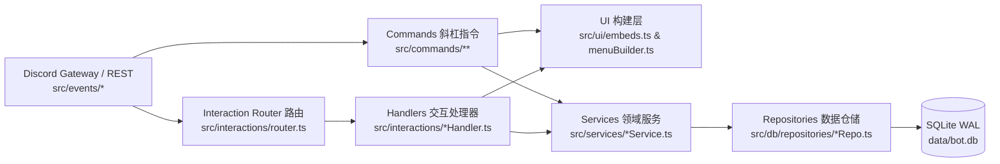
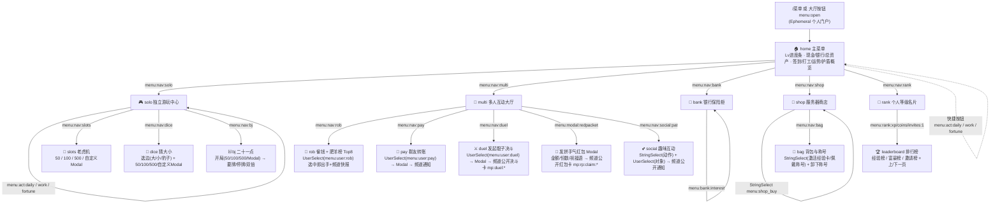

# 原生中文 Discord 多功能社群 Bot — 技术架构与运维文档

> 本文档面向项目维护者与二次开发者，基于当前代码库真实实现编写，涵盖分层架构、`/菜单` 全组件交互树与路由规范、全部 25 个斜杠指令、经济与玩法数值规则、SQLite 15 表结构与平滑迁移机制，以及开发、测试和生产部署指南。

---

## 1. 项目架构与分层设计

### 1.1 技术栈与工程约束

| 维度 | 选型与配置 | 说明 |
| --- | --- | --- |
| 运行时 | Node.js（ES2022 / `NodeNext` ESM） | 源码 `import` 统一使用 `.js` 扩展名 |
| 语言与编译 | TypeScript `^5.8.3` | 开启 `strict: true`、`noUncheckedIndexedAccess: true`、`noImplicitOverride: true` |
| 代码规范 | ESLint `^9.26.0` + `typescript-eslint` | `@typescript-eslint/no-explicit-any: "error"`，**严格零 `any`** |
| Discord SDK | `discord.js` `^14.19.3` | Slash Commands、Embed、ActionRow、Button、String/User Select、Modal |
| 数据库 | `better-sqlite3` `^11.10.0` | 单进程嵌入式 SQLite，生产文件库开启 `WAL` 与 `foreign_keys = ON` |
| 测试框架 | `vitest` `^3.1.3` | 使用 `:memory:` 与临时目录库隔离测试各层逻辑与路由 |
| 环境变量 | `dotenv` `^16.5.0` | 通过 `src/config/env.ts` 集中校验与解析 |

### 1.2 目录分层与数据流

项目采用单向依赖分层，确保业务逻辑可在不依赖 Discord Gateway 的情况下通过单元测试完整验证：



各目录职责说明：

- **`src/config/`**
  - `env.ts`：`parseEnv()` / `loadEnv()` 解析 `DISCORD_TOKEN`、`DISCORD_CLIENT_ID`、`DISCORD_GUILD_ID`、`DB_PATH`（默认 `./data/bot.db`）、`TIMEZONE`（默认 `Asia/Shanghai`）。
  - `defaults.ts`：定义 `ModuleToggles`、`LevelingConfig`、`EconomyConfig`、`WelcomeConfig`、`TicketConfig`、`GuildConfig` 接口及所有默认值常量。
- **`src/db/`**
  - `database.ts`：`createDatabase(dbPath)` 负责建目录、打开连接、设置 `journal_mode = WAL`（非内存库）与 `foreign_keys = ON`，并调用 `initSchema(db)`。
  - `schema.ts`：声明核心 13 张表并调用 `initRedPacketSchema(db)` 初始化红包 2 张表（共 15 张表），随后执行幂等列迁移。
  - `repositories/`：9 个 Repository 类（`GuildConfigRepo`、`ProfileRepo`、`ShopRepo`、`FunRepo`、`TicketRepo`、`GiveawayRepo`、`InviteRepo`、`RolePanelRepo`、`RedPacketRepo`），封装全部 SQL 读写与行映射。
- **`src/services/`**
  - 纯业务与事务编排层（`LevelingService`、`EconomyService`、`BlackjackManager`、`ShopService`、`FunService`、`TicketService`、`GiveawayService`、`InviteService`、`RolePanelService`、`MultiplayerService`、`permissionService.ts`、`welcomeService.ts`）。涉及跨表/双人资金变动的接口全部使用 `this.db.transaction(...)()` 保证原子性。
- **`src/ui/`**
  - `embeds.ts`：定义全局 `AppContext`、`CommandDefinition`、`COLORS`、进度条 `renderProgressBar()`、中文时长格式化 `formatDurationZh()` 以及 Embed 工厂方法。
  - `localization.ts`：封装 `applyZh()` / `applyZhName()` 为指令、子指令与选项注入 `zh-CN` / `zh-TW` 本地化名称和描述。
  - `menuBuilder.ts`：纯函数渲染器，构建大厅卡片 `buildLobbyMessage()`、个人互动面板 15 个子视图 `buildMenuMessage()`、公开决斗卡片 `buildDuelMessage()` 与公开红包卡片 `buildRedPacketMessage()`。
- **`src/interactions/`**
  - `router.ts`：统一接收所有 `Interaction` 并按类型与 `customId` 前缀分发；全局捕获异常并向用户返回友好错误提示（含 `50013` 权限不足识别）。
  - `*Handler.ts`：将交互解析为领域调用并响应（`menuHandler.ts`、`multiplayerHandler.ts`、`blackjackHandler.ts`、`leaderboardHandler.ts`、`helpHandler.ts`、`ticketHandler.ts`、`giveawayHandler.ts`、`rolePanelHandler.ts`）。
- **`src/commands/`**
  - `registry.ts`：汇总 25 个 `CommandDefinition` 并生成 `commandMap`。
  - `guards.ts`：提供 `requireGuildMember`、`requireModuleEnabled`、`requireBotAdmin` 统一鉴权守卫。

### 1.3 `AppContext`、Gateway Intents 与后台调度器生命周期

`src/index.ts` 启动时按顺序组装：

1. **Intents 声明**：
   - `Guilds`、`GuildMembers`（Privileged）、`GuildMessages`、`MessageContent`（Privileged）、`GuildVoiceStates`、`GuildInvites`。（另在 Developer Portal 中开启 `Presence Intent` 等全部 3 个 Privileged Intents）。
2. **`AppContext` 注入**：
   - 持有 `db`、`timezone`、9 个 `repos` 实例和 10 个 `services` 实例，传递给所有指令与交互处理器。
3. **事件注册**：
   - `ready.ts`（`ClientReady`）、`messageCreate.ts`（聊天经验）、`guildMemberAdd.ts`（邀请归因 + 自动身份组 + 欢迎 Embed）、`guildMemberRemove.ts`（离开通知）、`inviteEvents.ts`（`InviteCreate` / `InviteDelete` 实时维护内存邀请快照）、`interactionCreate.ts`（路由入口）。
4. **后台定时器（`src/events/ready.ts`）**：
   - **初始化任务**：设置状态 `正在观看 输入 /菜单 开始游玩 | /帮助`，并为所有已加入服务器拉取 `guild.invites.fetch()` 初始化邀请缓存（缺少 `ManageGuild` 权限时优雅跳过）。
   - **语音经验结算（`voiceTimer`，每 `60_000` ms / 60 秒）**：遍历语音频道中的非 Bot 成员；排除未进频道、位于服务器 `afkChannelId`、同时开启自闭麦与自闭听（`selfMute && selfDeaf`）及无真人在麦的情况；调用 `awardVoiceXp()` 并在升级时同步身份组与发送播报。
   - **抽奖自动开奖（`giveawayTimer`，每 `10_000` ms / 10 秒，带 `giveawayRunning` 防重入锁）**：拉取到期抽奖，执行 `finalizeGiveaway()` 更新原抽奖消息 Embed 并移除按钮，随后在原频道公开公告中奖者或流拍结果。
   - **红包过期退回（`redPacketTimer`，每 `15_000` ms / 15 秒，带 `redPacketRunning` 防重入锁）**：执行 `expireDueRedPackets()`，将过期未领完金额原子退回发包人口袋，编辑原红包卡片为过期状态并移除按钮，若 `refundedAmount > 0` 则在原频道发送退回提示 Embed。
5. **优雅退出**：监听 `SIGINT` / `SIGTERM`，依次执行 `schedulers.stop()`、`client.destroy()`、`db.close()`、`process.exit(0)`。

---

## 2. 可视化 `/菜单` 交互树与组件路由规范

### 2.1 `/菜单`（`/menu`）全视图交互树

用户可通过任意频道发送 `/菜单`（默认 `personal` 模式，Ephemeral 仅自己可见），或点击管理员通过 `/菜单 模式:lobby` 发送的永久大厅卡片按钮 `menu:open`，进入以下 15 个视图组成的完整交互面板：



### 2.2 全量 `customId` 前缀路由规范

`src/interactions/router.ts` 通过 `interaction.customId.split(':')[0]` 提取前缀分发到对应处理器（`ticket:create` 模态框使用精确匹配）：

| 前缀 | 交互类型 | 处理器函数 | 完整 `customId` 格式与用途 |
| --- | --- | --- | --- |
| `menu` | Button | `handleMenuButton` | `menu:open`（大厅开菜单）<br/>`menu:nav:<page>`（切换页面，`social` 可带 `:<action>`）<br/>`menu:act:<daily\|work\|fortune>`（快捷动作，自动识别原页为 `home` 或 `solo`）<br/>`menu:slots:<50\|100\|500>`（老虎机定额下注）<br/>`menu:dice_pick:<big\|small\|triple>`（切换猜大小投注边）<br/>`menu:dice_bet:<choice>:<50\|100\|500>`（猜大小定额下注）<br/>`menu:bj_start:<50\|100\|500>`（二十一点定额开局）<br/>`menu:bj:<hit\|stand\|double>`（二十一点牌局操作）<br/>`menu:bank:<dep\|wd>:<25\|50\|all>`（银行比例存取）<br/>`menu:bank:interest`（领取每日银行利息）<br/>`menu:bag:clear_title`（卸下当前佩戴称号）<br/>`menu:rank:<xp\|coins\|invites>:<page>[:prev\|:next]`（排行榜切换与翻页）<br/>`menu:modal:<slots\|dice:<choice>\|bj\|bank_dep\|bank_wd\|redpacket>`（弹窗入口） |
| `menu` | StringSelect | `handleMenuStringSelect` | `menu:social_act`（切换趣味互动动作并保留原视图）<br/>`menu:shop_buy`（选择商品 ID 购买；身份组发放失败自动退款退库存）<br/>`menu:bag_use`（使用经验加成卡或切换佩戴称号） |
| `menu` | UserSelect | `handleMenuUserSelect` | `menu:user:rob`（选中即打劫，更新个人面板并向当前频道发快报）<br/>`menu:user:pay`（校验非 Bot/非本人后直接弹出转账金额 Modal）<br/>`menu:user:duel`（校验后直接弹出决斗赌注 Modal）<br/>`menu:user:social:<action>`（执行互动并在当前频道公开播报） |
| `menu` | ModalSubmit | `handleMenuModal` | `menu:modal_sub:slots` / `menu:modal_sub:dice:<choice>` / `menu:modal_sub:bj`<br/>`menu:modal_sub:bank_dep` / `menu:modal_sub:bank_wd`<br/>`menu:modal_sub:pay:<targetId>`<br/>`menu:modal_sub:duel:<opponentId>`<br/>`menu:modal_sub:redpacket` |
| `mp` | Button | `handleMultiplayerButton` | `mp:duel:accept:<duelId>`（应战并原子结算公开决斗卡片）<br/>`mp:duel:decline:<duelId>`（挑战双方取消或拒绝决斗）<br/>`mp:rp:claim:<packetId>`（抢红包；实时刷新公开卡片并私信 `followUp` 金额） |
| `lb` | Button | `handleLeaderboardButton` | `lb:<xp\|coins\|invites>:<page>`（`/排行榜` 独立消息的切榜与翻页） |
| `bj` | Button | `handleBlackjackButton` | `bj:<hit\|stand\|double>:<ownerId>`（`/二十一点` 独立牌局按钮，校验仅开局本人可点） |
| `help` | StringSelect | `handleHelpSelect` | `help:category`（`/帮助` 模块分类下拉切换） |
| `ticket` | Button / Modal | `handleTicketButton` / `handleTicketModal` | `ticket:open`（打开提交客服工单 Modal）<br/>`ticket:close`（关闭工单，写日志并 5 秒后删频道）<br/>`ticket:create`（Modal 提交后创建私密工单频道） |
| `giveaway` | Button | `handleGiveawayButton` | `giveaway:join:<giveawayId>`（报名/退出抽奖，校验最低等级与身份组门槛） |
| `rolepanel` | Button / StringSelect | `handleRolePanelButton` / `handleRolePanelSelect` | `rolepanel:btn:<panelId>:<roleId>`（按钮切换身份组）<br/>`rolepanel:select:<panelId>`（下拉菜单批量同步单选/多选身份组） |

### 2.3 Ephemeral 隔离与公开广播策略

- **个人私密操作（全 Ephemeral 就地更新）**：`/菜单`（`personal`）、点击大厅按钮 `menu:open`、面板内所有页面跳转、签到、打工、运势、老虎机、猜大小、二十一点、银行存取与领息、商店购买、背包使用、个人名片与排行榜翻页，均在原 Ephemeral 消息上通过 `interaction.update()` 原地刷新，绝不在公共频道刷屏。
- **社交触发型公开广播（菜单就地更新 + 频道公开广播）**：
  - **偷钱（`menu:user:rob`）**：原 Ephemeral 面板更新结果反馈，同时通过 `channel.send()` 在频道发布得手/被抓快报。
  - **转账（`menu:modal_sub:pay:*`）**：原 Ephemeral 面板更新余额反馈，同时在频道发送转账成功 Embed。
  - **趣味互动（`menu:user:social:*`）**：在频道发送带累计互动次数的 Embed，并更新 Ephemeral 面板提示。
  - **骰子决斗与拼手气红包**：在当前频道发出带 `mp:*` 公开按钮的公共卡片；他人点击时，原公共卡片原地 `interaction.update()` 刷新进度/结算状态，抢红包结果与异常校验则通过 `followUp` / `reply` + `MessageFlags.Ephemeral` 仅通知点击者本人。

### 2.4 Discord 组件硬限制与工程护栏

代码库（含 `tests/ui/menuBuilder.test.ts` 与 `tests/interactions/menuRouter.test.ts`）强制校验以下 Discord API 约束：

1. **组件布局上限**：每条消息最多 `5` 个 `ActionRow`；每行最多 `5` 个按钮；`StringSelectMenu` 与 `UserSelectMenu` 必须独占一整行（`row.components.length === 1`）。
2. **下拉菜单选项上限**：每个 `StringSelectMenu` 必须在 `1 ~ 25` 个选项之间。商店与背包视图在渲染前执行 `.slice(0, 25)` 并于描述中注明总数；身份组面板在 `addOption()` 限制最多 `25` 个。
3. **字符串长度截断**：`truncateText()` 保障按钮标签 `<= 80` 字符，Select 选项 `label`/`description` `<= 100` 字符，Embed `title <= 256`、`description <= 4096`，`customId <= 100` 且同一消息内不重复。
4. **`showModal()` 响应时序铁律**：Discord 规定 `showModal()` 必须是交互的**首次且唯一**响应，**严禁**在其前面调用 `deferUpdate()`、`reply()` 或 `update()`。`menuHandler.ts` 中 `menu:modal:*`、`menu:user:pay`、`menu:user:duel` 均严格遵守该顺序。
5. **Modal 回写原面板 (`isFromMessage()`)**：`respondFromModal()` 判断 `interaction.isFromMessage()`，为 `true` 时调用 `interaction.update(msg)` 直接刷新原 Ephemeral 面板，防止每填一次弹窗就多弹出一条新消息。
6. **频道可发送守卫 (`channel?.isSendable()`)**：所有需要向频道发送公开大厅、转账通知、决斗卡片、红包卡片、互动播报或过期退款通知的逻辑，均先检查 `interaction.channel?.isSendable()`（及发送异常兜底回滚）。

---

## 3. 全部 25 个斜杠指令清单

所有指令定义汇总于 `src/commands/registry.ts`（`commands` 数组共 25 个）。默认使用 `applyZh()` 将 `zh-CN` 同步写入 `zh-TW`；`/menu` 额外显式配置繁体名称 `選單`。

| # | 英文指令 | `zh-CN` | `zh-TW` | 所属模块 | 权限 | 用途说明 |
| --- | --- | --- | --- | --- | --- | --- |
| 1 | `/help` | `/帮助` | `/帮助` | 通用 | 所有成员 | 查看全部功能说明与交互式模块分类下拉菜单 |
| 2 | `/menu` | `/菜单` | `/選單` | 通用 / 全功能 | 成员 / 管理员(`lobby`) | 打开个人 Ephemeral 互动主面板，或由管理员在频道发送永久大厅入口按钮 |
| 3 | `/config` | `/设置` | `/设置` | 通用配置 | 管理员 | 查看配置、开关 8 大功能模块、增删 Bot 管理员身份组、设置忽略经验频道与频道经验倍率 |
| 4 | `/rank` | `/等级` | `/等级` | 等级与热度 | 所有成员 | 查看自己或指定成员的等级、经验进度条、全服排名、聊天热度倍率、经验卡与活跃统计 |
| 5 | `/leaderboard` | `/排行榜` | `/排行榜` | 等级与综合 | 所有成员 | 查看经验榜、星币富豪榜（含银行资产）或邀请贡献榜（带按钮翻页与切榜） |
| 6 | `/level-admin` | `/等级管理` | `/等级管理` | 等级与热度 | 管理员 | 配置升级奖励身份组、升级播报频道、语音挂机经验、热度/冷却/小时上限参数及设置用户经验 |
| 7 | `/daily` | `/签到` | `/签到` | 经济系统 | 所有成员 | 领取每日签到星币（连签递增加成，按配置时区日切） |
| 8 | `/work` | `/打工` | `/打工` | 经济系统 | 所有成员 | 触发随机打工事件赚取星币（带冷却限制） |
| 9 | `/rob` | `/打劫` | `/打劫` | 经济系统 | 所有成员 | 尝试偷取群友口袋现金（银行存款免疫；失败需赔款，被抢触发护盾） |
| 10 | `/balance` | `/钱包` | `/钱包` | 经济系统 | 所有成员 | 查询自己或他人的口袋现金、银行存款、总资产、连签天数与佩戴称号 |
| 11 | `/pay` | `/转账` | `/转账` | 经济系统 | 所有成员 | 从口袋现金向指定群友直接转账 |
| 12 | `/dice` | `/猜大小` | `/猜大小` | 经济系统 | 所有成员 | 三颗骰子押大（1x）、押小（1x）或押豹子（10x） |
| 13 | `/slots` | `/老虎机` | `/老虎机` | 经济系统 | 所有成员 | 拉动加权老虎机，三连 `7️⃣` 最高 15 倍返还 |
| 14 | `/blackjack` | `/二十一点` | `/二十一点` | 经济系统 | 所有成员 | 开始一局独立互动二十一点扑克（按钮要牌 / 停牌 / 双倍下注） |
| 15 | `/shop` | `/商店` | `/商店` | 经济系统 | 成员 / 管理员 | 浏览和购买身份组、称号、经验卡；管理员上/下架商品 |
| 16 | `/inventory` | `/背包` | `/背包` | 经济系统 | 所有成员 | 查看背包道具与称号，激活经验加成卡或切换佩戴称号 |
| 17 | `/fortune` | `/运势` | `/运势` | 娱乐互动 | 所有成员 | 抽取今日运势签（大吉~小凶、宜/忌、幸运数字，首抽赠星币） |
| 18 | `/interact` | `/互动` | `/互动` | 娱乐互动 | 所有成员 | 对群友发起摸头/抱抱/贴贴/戳一戳/投喂/丢雪球并累计交互次数 |
| 19 | `/title` | `/称号` | `/称号` | 娱乐互动 | 成员 / 管理员(`grant`) | 查看、佩戴、卸下个人称号，或由管理员授予成员专属称号 |
| 20 | `/welcome-config` | `/欢迎设置` | `/欢迎设置` | 欢迎与离开 | 管理员 | 设置入群欢迎语、离开提示、自动身份组、功能开关与实时预览 |
| 21 | `/ticket-config` | `/工单设置` | `/工单设置` | 工单系统 | 管理员 | 配置工单分类、客服身份组、日志频道、并发上限与发送「创建工单」面板 |
| 22 | `/ticket` | `/工单` | `/工单` | 工单系统 | 客服 / 创建者 | 在开启中的工单频道内拉入成员、移除成员或关闭工单 |
| 23 | `/giveaway` | `/抽奖` | `/抽奖` | 抽奖系统 | 管理员 | 发起带门槛的定时抽奖、提前开奖、重抽与查看进行中列表 |
| 24 | `/invites` | `/邀请` | `/邀请` | 邀请追踪 | 所有成员 | 查看自己或指定成员的累计成功邀请数与近期邀请记录 |
| 25 | `/role-panel` | `/身份组面板` | `/身份组面板` | 自助身份组 | 管理员 | 创建与发布支持按钮/下拉菜单、单选互斥/多选的自助身份组面板 |

> 注：**Bot 管理员权限 (`requireBotAdmin`)** 满足以下任一条件即可通过：服务器 `Administrator` 权限、`ManageGuild` 权限，或成员持有通过 `/设置 添加管理员身份组` 配置的 `adminRoleIds`。

---

## 4. 核心玩法与经济数值规则

### 4.1 等级、经验公式与聊天热度连击

代码位置：`src/services/levelingService.ts`、`src/config/defaults.ts`、`src/events/ready.ts`。

- **升级所需经验公式**（从 `level` 升至 `level + 1`）：
  $$\text{XP}_{\text{next}}(L) = 100 + 75L + 15L^2$$
- **聊天经验计算链路**（`awardMessageXp`）：
  1. 检查模块开关、忽略频道、发言冷却（默认 `cooldownSec = 15` 秒）。
  2. 计算热度窗口：若 `nowMs - lastXpAt <= heatWindowSec * 1000`（默认 `180` 秒），`heatStreak + 1`，否则重置为 `1`。
  3. 基础随机经验：`baseXp ∈ [baseMinXp, baseMaxXp]`（默认 `15 ~ 25`）。
  4. 最终经验：`Math.max(1, Math.round(baseXp * heatMultiplier * channelMultiplier * boostMultiplier))`。
  5. **每小时经验上限**：默认 `hourlyXpCap = 1200` XP（滑动 `3_600_000` ms 窗口；设为 `0` 表示不限制）。
- **聊天热度连击倍率阶梯**（`getHeatMultiplier`，受限于 `heatMaxMultiplier`，默认上限 `2.0x`）：

| 连续有效发言次数 (`heatStreak`) | 原始热度倍率 |
| --- | --- |
| `< 2`（0 或 1 次） | `1.0x` |
| `>= 2` | `1.25x` |
| `>= 4` | `1.5x` |
| `>= 6` | `1.75x` |
| `>= 8` | `2.0x` |

- **语音挂机经验**：默认开启，每 `60` 秒结算 `voiceXpPerMin = 10` XP（乘以激活中的经验卡倍率，受 `hourlyXpCap` 约束，**不吃热度倍率**）。不计入 Bot、AFK 频道及同时自闭麦+自闭听成员。
- **升级奖励**：每升 1 级默认赠送 `levelUpCoinReward = 100` 星币；若配置了等级身份组奖励，根据 `stackRoles` 决定叠加保留（`true`）或仅保留最高级（`false`）。

### 4.2 口袋现金 vs 银行保险柜与每日利息

代码位置：`src/services/economyService.ts`、`src/db/repositories/profileRepo.ts`。

| 资产类型 | 数据库字段 | 用途与规则 |
| --- | --- | --- |
| **口袋现金** | `member_profiles.coins` | 日常流动资金：用于玩小游戏（老虎机/猜大小/二十一点）、商店消费、转账、发起/接受决斗、发红包；**可被其他成员打劫** |
| **银行存款** | `member_profiles.bank_coins` | 安全储蓄：仅可在 `/菜单` → `银行存钱` 存取；**完全免疫 `/打劫` 与偷钱**（`rob()` 既不读取也不扣减 `bankCoins`） |
| **总资产排行** | `coins + bank_coins` | 富豪榜按 `(coins + bank_coins) DESC, coins DESC, xp DESC` 排序 |

- **银行每日利息规则**（`claimBankInterest`）：
  - 默认配置：`bankInterestRate = 0.02`（2%）、`bankInterestMax = 500` 星币/日、`bankInterestMinDeposit = 100` 星币。
  - 日切判断：基于 `getDateKey(nowMs, timezone)`（默认 `Asia/Shanghai`，即 **UTC+8 零点重置**），校验 `lastBankInterestDate === today`；每日限领一次。
  - 利息计算：当 `bankCoins >= bankInterestMinDeposit` 时：
    $$\text{interest} = \max\left(1, \min\left(\text{bankInterestMax}, \lfloor \text{bankCoins} \times \text{bankInterestRate} \rfloor\right)\right)$$
  - 利息直接原子计入 `bankCoins`，不进入口袋现金。

### 4.3 签到、打工与打劫规则

- **每日签到（`claimDaily`）**：基础 `dailyBase = 200`；若昨日已签则 `dailyStreak + 1`，否则重置为 `1`；连签加成 `Math.min((streak - 1) * 30, 300)`（默认最高合计 `500` 星币/天），按 `TIMEZONE` 日切。
- **打工（`work`）**：随机收益 `[80, 220]`（可配），冷却 `workCooldownSec = 1800` 秒（30 分钟）。
- **偷钱 / 打劫（`rob`）**：
  - 冷却：`robCooldownSec = 3600` 秒（1 小时）；肥羊榜 (`listRobTargets`) 展示口袋现金 `>= 100` 的前 8 名非本人成员。
  - 目标门槛：仅允许打劫 `target.coins >= 100` 且不在护盾期内的用户（不可打劫自己或 Bot）。
  - **成功**（概率 `robSuccessRate = 0.45`）：偷走目标口袋现金 `15% ~ 35%`（钳制在 `[15, 1000]` 且不超过目标实际现金），同时为目标开启 `robTargetShieldSec = 3600` 秒（1 小时）防盗护盾。
  - **失败**（概率 `55%`）：攻击者向目标赔偿自己口袋现金的 `15%`（钳制在 `[50, 500]` 且不超过攻击者现有现金）；攻击者进入 1 小时冷却，目标不触发护盾。

### 4.4 个人娱乐与赌场赔率

- **每日运势（`FunService.drawDailyFortune`）**：按 `TIMEZONE` 每日一签，6 档运势及首抽固定范围内随机彩头：大吉（60~80）、中吉（45~65）、小吉（30~50）、吉（25~40）、末吉（15~30）、小凶（10~20）。同日重复抽签展示同一签文，不重复发币。
- **幸运老虎机（`playSlots`）**：符号权重为 `🍒(30)`、`🍋(25)`、`🍇(20)`、`🔔(13)`、`💎(8)`、`7️⃣(4)`（总权重 100）。倍率：`7️⃣×3 = 15x`、`💎×3 = 8x`、其余三连 `4x`、任意两连 `1.5x`、全不中 `0x`；返还 `Math.floor(bet * multiplier)`。
- **猜大小（`playDice`）**：投掷 3 颗 1~6 骰子。若三颗点数相同（豹子），则**通杀大小**，仅押 `triple` 中奖（`10x` 净利）；非豹子时，`sum >= 11` 为 `big`、`sum <= 10` 为 `small`（均 `1x` 净利）。
- **二十一点（`BlackjackManager`）**：内存存储对局（键 `${guildId}:${userId}`）。开局扣赌注；玩家天胡 Blackjack 赔付 `Math.floor(bet * 2.5)`（双方同 Blackjack 退回本金 `push`）；普通胜或庄家爆牌赔付 `bet * 2`；庄家停牌点 `< 17` 必拿牌；仅首轮两张牌且口袋现金足够时支持双倍下注（`doubleDown`）。

### 4.5 拼手气红包与 PVP 骰子决斗

代码位置：`src/services/multiplayerService.ts`、`src/interactions/multiplayerHandler.ts`。

- **拼手气红包（二倍均值算法 + 过期自动退回）**：
  - 限制：份数 `totalCount ∈ [2, 20]`，总金额 `totalAmount ∈ [1, 1_000_000]` 且 `totalAmount >= totalCount`（保证每份至少 `1` 星币）。默认有效期 `24` 小时（`86_400_000` ms）。
  - 创建时在 `db.transaction` 中立即从发包人口袋扣款；若随后 `channel.send()` 失败，事务标记红包过期并立即全额退款。
  - **二倍均值分配算法**（`claimRedPacket`）：
    - 当剩余份数 `remainingCount === 1` 时，直接分出全部 `remainingAmount`，确保总金额一分不差。
    - 否则计算当前最大可抢上限：
      $$\text{maxShare} = \max\left(1, \min\left(\text{remainingAmount} - (\text{remainingCount} - 1), \left\lfloor \frac{\text{remainingAmount}}{\text{remainingCount}} \times 2 \right\rfloor\right)\right)$$
      再随机抽取 `[1, maxShare]` 整数。
  - **手气最佳**：仅当全部领完（`status === 'finished'`）时计算抢得金额最多者（相同金额先抢者优先）。
  - **过期退回**：由 `ready.ts` 每 15 秒扫描 `listDueOpen(nowMs)`，或在过期的红包卡片被点击时触发，将未领取余额原子退回发包人口袋。
- **PVP 骰子决斗（原子结算）**：
  - 赌注 `1 ~ 1,000,000`，挑战自己或 Bot 会被拦截。
  - 挑战有效期 `3` 分钟（`180_000` ms），内存 `Map` 最多保留 `100` 条（超时/已结束自动清理）。
  - 创建挑战时仅校验发起人口袋余额，不提前锁定资金；当被挑战者点击 `mp:duel:accept:<id>` 时，在 `db.transaction` 内**重新锁定校验双方实时口袋余额**，各自掷 3 颗骰子比拼总点数（3~18），胜者净赢 `+bet`、败者净输 `-bet`，平局不扣款。

---

## 5. SQLite 数据库 Schema 与平滑迁移机制

### 5.1 连接配置与 Pragmas

`src/db/database.ts` 初始化行为：
- 若为文件路径（非 `:memory:` 且非 `file::memory:`），自动递归创建父目录并开启 `PRAGMA journal_mode = WAL`。
- 无论内存库或文件库，统一开启 `PRAGMA foreign_keys = ON` 以启用外键级联删除（`ON DELETE CASCADE`）。

### 5.2 全部 15 张表清单

初始化入口为 `initSchema(db)`（`src/db/schema.ts`），包含 `SCHEMA_SQL` 的 13 张表以及通过 `initRedPacketSchema(db)`（`src/db/repositories/redPacketRepo.ts`）创建的 2 张红包表：

| # | 表名 | 主键 / 唯一约束 | 关键索引 / 外键 | 核心用途 |
| --- | --- | --- | --- | --- |
| 1 | `guild_configs` | `PK(guild_id)` | — | 服务器模块开关、管理员身份组、各模块 JSON 配置及工单自增计数 |
| 2 | `member_profiles` | `PK(guild_id, user_id)` | `idx_member_profiles_xp(guild_id, xp DESC)`<br/>`idx_member_profiles_coins(guild_id, coins DESC)` | 成员等级、XP、发言/语音统计、口袋 `coins`、银行 `bank_coins`、连签、护盾、称号、经验卡与热度状态 |
| 3 | `level_role_rewards` | `PK(guild_id, level)` | — | 等级阈值与自动发放身份组 ID 映射 |
| 4 | `shop_items` | `PK(id AUTOINCREMENT)` | `idx_shop_items_guild(guild_id, id)` | 商店商品（`role` / `title` / `xp_boost`）、价格与库存 |
| 5 | `user_inventory` | `PK(id AUTOINCREMENT)` | `idx_user_inventory_owner(guild_id, user_id)` | 成员背包道具与已解锁称号 |
| 6 | `fun_fortunes` | `PK(guild_id, user_id, date_key)` | — | 每日运势签记录与首抽奖励防重 |
| 7 | `fun_interactions` | `PK(guild_id, actor_id, target_id, action)` | — | 群友间 6 种互动动作累计次数 |
| 8 | `tickets` | `PK(id AUTOINCREMENT)`<br/>`UNIQUE(channel_id)` | `idx_tickets_guild_creator_status(guild_id, creator_id, status)` | 客服工单记录（`open` / `closed`） |
| 9 | `giveaways` | `PK(id AUTOINCREMENT)`<br/>`UNIQUE(message_id)` | `idx_giveaways_due(ended, ends_at)` | 抽奖配置、门槛、截止时间与中奖名单 JSON |
| 10 | `giveaway_entries` | `PK(giveaway_id, user_id)` | `FK(giveaway_id) -> giveaways(id) ON DELETE CASCADE` | 抽奖报名记录 |
| 11 | `invite_records` | `PK(id AUTOINCREMENT)`<br/>`UNIQUE(guild_id, invitee_id)` | `idx_invite_records_inviter(guild_id, inviter_id)` | 成员入群邀请归因记录 |
| 12 | `role_panels` | `PK(id AUTOINCREMENT)` | — | 自助身份组面板（`button`/`select`、`multi`/`single`） |
| 13 | `role_panel_options` | `PK(id AUTOINCREMENT)` | `idx_role_panel_options_panel(panel_id, sort_order)`<br/>`FK(panel_id) -> role_panels(id) ON DELETE CASCADE` | 面板包含的身份组选项（最多 25 项） |
| 14 | `red_packets` | `PK(id AUTOINCREMENT)` | `idx_red_packets_due(status, expires_at)` | 拼手气红包主记录（总金额/余量、份数、状态、过期时间戳） |
| 15 | `red_packet_claims` | `PK(packet_id, user_id)` | `FK(packet_id) -> red_packets(id) ON DELETE CASCADE` | 红包领取流水，主键天然防同一用户重复抢包 |

### 5.3 幂等列迁移机制 (`PRAGMA table_info`)

为确保已有生产数据库在无停机重建的情况下平滑升级，`initSchema(db)` 在执行建表语句后采用基于 `PRAGMA table_info` 的幂等迁移逻辑：

```ts
const columns = db.pragma('table_info(member_profiles)') as Array<{ name: string }>;
const columnNames = new Set(columns.map((col) => col.name));

if (!columnNames.has('bank_coins')) {
  db.exec('ALTER TABLE member_profiles ADD COLUMN bank_coins INTEGER NOT NULL DEFAULT 0;');
}
if (!columnNames.has('last_bank_interest_date')) {
  db.exec('ALTER TABLE member_profiles ADD COLUMN last_bank_interest_date TEXT;');
}
```

- **行为保证**：旧版本 v1 数据库中已有的 `coins`、经验等数据完全保留，自动补全 `bank_coins = 0` 与 `last_bank_interest_date = NULL`；多次重复调用 `initSchema(db)` 幂等无报错（见 `tests/db/schema.test.ts` 迁移用例）。
- **扩展规范**：后续若需新增字段，应同步更新 `SCHEMA_SQL` 与 `PRAGMA table_info` 条件 `ALTER TABLE`，禁止破坏已有列数据。

---

## 6. 开发规范、测试、指令同步与通用部署指南

### 6.1 常用脚本命令 (`package.json`)

| 命令 | 执行内容 | 用途 |
| --- | --- | --- |
| `pnpm run dev` | `tsx watch src/index.ts` | 本地热重载开发运行 |
| `pnpm run typecheck` | `tsc --noEmit` | 严格 TypeScript 类型检查 |
| `pnpm run lint` | `eslint src tests` | 代码规范检查（含禁止任何 `any`） |
| `pnpm test` | `vitest run` | 运行全部单元测试与交互集成测试 |
| `pnpm run build` | `tsc` | 编译输出 ESM 产物到 `dist/` |
| `pnpm run deploy-commands` | `tsx src/deploy-commands.ts` | 同步全部 25 个斜杠指令及中文本地化到 Discord |
| `pnpm run e2e` | `tsx src/scripts/e2e-check.ts` | 连续 3 次调用真实 Discord REST API 校验连通性与全局指令数 |
| `pnpm start` | `node dist/index.js` | 运行编译后的生产构建产物 |

### 6.2 代码规范与安全底线

1. **零 `any` 约束**：`eslint.config.mjs` 强制启用 `@typescript-eslint/no-explicit-any: 'error'`，严禁使用 `: any`、`as any` 或 `<any>`；请使用精确接口、`unknown` 与类型守卫。
2. **秘密信息隔离**：严禁向 Git 仓库提交 `.env`、`*.db`、`DISCORD_TOKEN`、真实服务器 IP、SSH 端口或个人账号 ID；文档与示例一律使用 `<YOUR_BOT_TOKEN>`、`<YOUR_CLIENT_ID>`、`<YOUR_VPS_HOST>` 等占位符。
3. **测试先行**：修改组件、数据库结构或服务逻辑后，需同时通过 `pnpm run typecheck`、`pnpm run lint`、`pnpm test` 和 `pnpm run build`。

### 6.3 Discord Developer Portal 关键配置（避坑清单）

1. **Privileged Gateway Intents（必须全部打开 3 项）**：
   - 在 **Bot** 页面开启：`Presence Intent`、`Server Members Intent`、`Message Content Intent`。
2. **关闭 `Requires OAuth2 Code Grant`（常见邀请报错根因）**：
   - 若使用 OAuth2 邀请链接时遇到 `Integration requires code grant` 报错：打开 Developer Portal **Bot（机器人）** 页面，在 **Public Bot（公开机器人）** 下关闭第 2 个开关 **Requires OAuth2 Code Grant**，保存后再打开邀请链接。
3. **OAuth2 邀请权限**：
   - Scopes 勾选 `bot`、`applications.commands`。
   - Bot Permissions 至少勾选：`Manage Roles`、`Manage Channels`、`Manage Guild`（邀请追踪所需）、`Send Messages`、`Embed Links`、`Read Message History`、`View Channels`。
4. **身份组层级顺序**：
   - 进入服务器设置 → 身份组，**务必将 Bot 自身的身份组拖动到所有奖励身份组、商店商品身份组及自助身份组之上**，否则发放或移除身份组会报 Discord `50013` 权限不足。

### 6.4 环境变量与指令同步

```bash
cp .env.example .env
```

编辑 `.env`（使用你自己的凭据替换占位符）：

```dotenv
DISCORD_TOKEN=<YOUR_BOT_TOKEN>
DISCORD_CLIENT_ID=<YOUR_CLIENT_ID>
# 可选：填写测试服务器 ID 可实现秒级同步；留空则向所有服务器全局注册（生效约数分钟）
DISCORD_GUILD_ID=<OPTIONAL_TEST_GUILD_ID>
DB_PATH=./data/bot.db
TIMEZONE=Asia/Shanghai
```

安装依赖、编译、同步斜杠指令并验证 Discord REST 连通性：

```bash
pnpm install
pnpm run build
pnpm run deploy-commands
pnpm run e2e
```

> 若在需要 HTTP/HTTPS 代理才能访问 Discord API 的本地环境运行 `deploy-commands` 或 `e2e`，需在 Node.js 22+ 环境中附带环境变量 `NODE_USE_ENV_PROXY=1`。

### 6.5 通用生产部署与升级（systemd / PM2）

仓库自带 [deploy/discord-bot.service](../deploy/discord-bot.service) 与 [ecosystem.config.cjs](../ecosystem.config.cjs)。以下为部署到 `<YOUR_VPS_HOST>` 的通用流程（示例目录 `/opt/zh-discord-bot`）：

#### 首次部署（systemd）

```bash
# 1. 拉取代码并准备环境变量
sudo mkdir -p /opt/zh-discord-bot
git clone https://github.com/icebear0828/discord-zh-bot.git /opt/zh-discord-bot
cd /opt/zh-discord-bot
cp .env.example .env
# 编辑 .env 填入 <YOUR_BOT_TOKEN> 与 <YOUR_CLIENT_ID>（生产环境建议留空 DISCORD_GUILD_ID 以走全局命令）

# 2. 安装、构建并注册全局指令
npm install
npm run build
npm run deploy-commands
npm prune --omit=dev

# 3. 注册 systemd 服务（建议配置 NODE_OPTIONS=--max-old-space-size=256 与 MemoryMax=384M）
sudo cp deploy/discord-bot.service /etc/systemd/system/zh-discord-bot.service
sudo systemctl daemon-reload
sudo systemctl enable --now zh-discord-bot
sudo journalctl -u zh-discord-bot -f
```

#### 日常发布升级

```bash
cd /opt/zh-discord-bot
git pull
npm install
npm run build
# 若本次更新增改了斜杠指令名称/选项/本地化，需再执行一次：
# npm run deploy-commands
npm prune --omit=dev
sudo systemctl restart zh-discord-bot
sudo systemctl status zh-discord-bot --no-pager
```

#### 数据备份与迁移

SQLite 运行在 `WAL` 模式，数据库活动写入同时分布在 `data/bot.db`、`data/bot.db-wal` 与 `data/bot.db-shm`：

- **冷备份（推荐）**：`sudo systemctl stop zh-discord-bot` 后打包备份整个 `data/` 目录，再启动服务。
- **热备份**：使用 `sqlite3 data/bot.db ".backup '/path/to/backup/bot.db'"` 安全导出一致性快照（不要在进程运行时仅单独复制 `bot.db` 而遗漏 `-wal`）。
